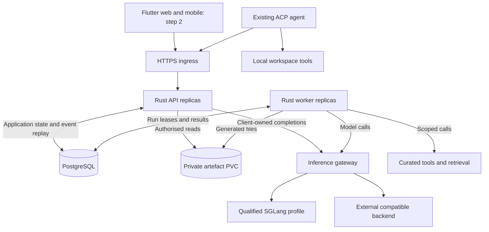
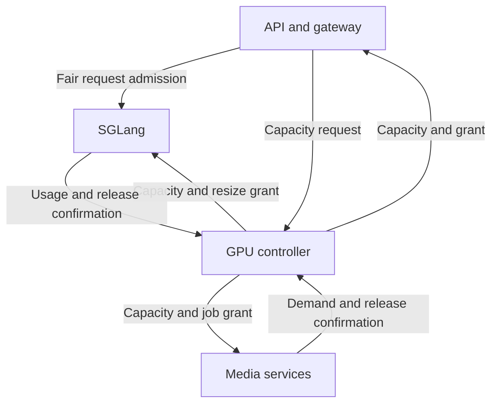
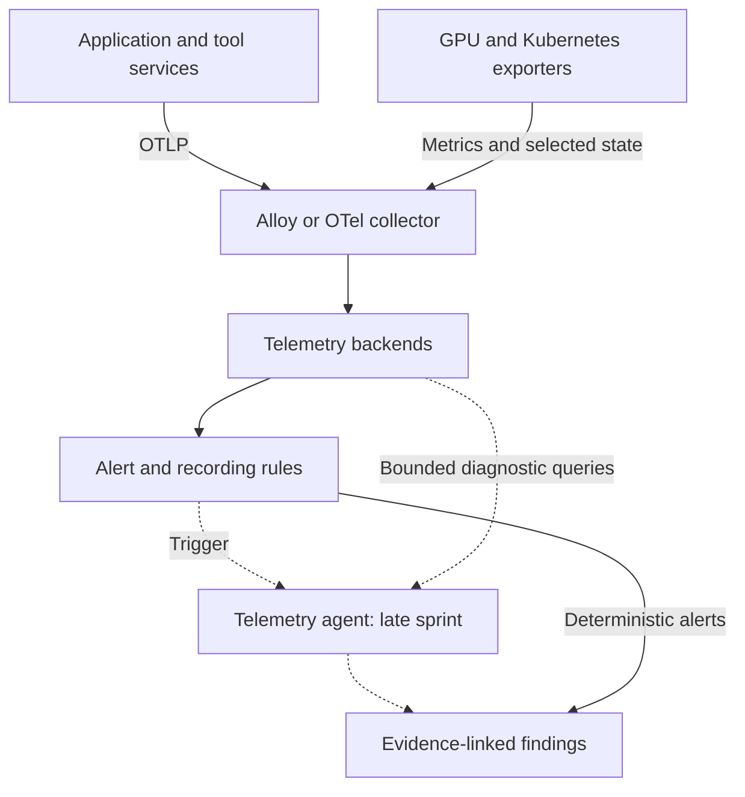

# OpenMettle architecture and scope baseline v1

**Architecture baseline v1 — accepted 16 November 2026.** The foundational product, service and operational decisions are settled for the first implementation. Deliver incrementally on the owner's workstation, with the Rust backend and APIs first and Flutter second. Detailed contracts, deployment values, experiments and qualification gates remain implementation work. Record subsequent changes to accepted decisions in a versioned decision record.

**Direction:** build a generic, deployable OpenMettle Kubernetes architecture with Rust API/worker services. **Agreed delivery order: step 1 delivers the backend and its APIs; step 2 delivers Flutter as the web/mobile presentation layer consuming those APIs.** Backend delivery and qualification do not depend on a Flutter prototype. The first iteration is a fresh build for one developer/operator on a single workstation, assembled and exercised piece by piece; no legacy-data migration is required. The core is GPU-independent; GPU services are opt-in deployment packages. Retain the ACP agent and useful curated services, with the owner's patched SGLang build as the reference inference backend, including elastic KV cache in the first managed-inference increment, and a versioned compatibility contract for other backends. Keep machine-specific settings in deployment profiles. The initial curated GPU implementation focuses on AMD; add qualified NVIDIA and other device profiles later. DRA is the allocation interface for managed Kubernetes GPU packages, not a prerequisite for installing the core.

## Core and optional deployment packages

**Initial delivery scope:** the target build-out includes the core, the owner's curated SGLang fork with elastic KV cache from the first inference increment, image/video generation, accelerated embedding/reranking and user-configured external backends. Deliver these as working increments on the owner's single workstation. The first useful increment does not wait for full feature parity or an importer. GPU packages remain opt-in for deployment and the agreed capabilities remain in scope. Keep service boundaries explicit so the application can be developed and upgraded independently of accelerated services. Hardware coverage remains AMD-first, with other device profiles added later.

| Package | Role | Dependency boundary |
| --- | --- | --- |
| Core | Rust API/run workers, PostgreSQL, gateway integration and configured artifact storage; Flutter web delivery joins in step 2 | Runs on CPU; no GPU, DRA API or vendor operator required |
| Managed inference | Owner's patched SGLang service, elastic KV cache and qualified hardware/runtime profile | Optional GPU package; requires a qualified DRA/CDI/vendor stack |
| Accelerated tools | Image/video generation and optionally accelerated embedding/reranking | Enable independently; each declares its backend and hardware dependencies |
| External providers | User-configured compatible inference/tool endpoints | No local GPU component required; current authorization and provider policy still apply |

When a package is disabled, its manifests and resource claims are absent and core startup/readiness do not query its CRDs or wait for its services. Infrastructure bootstrap manages cluster-scoped drivers separately from the application chart and reuses compatible installations. Enabled packages are validated independently; an unavailable provider is reported through capabilities/health and affected requests, rather than making the core unavailable. With no inference backend configured, the core remains available for setup and administration.

Represent installed, authorized and ready capabilities explicitly. Optional model/tool features are exposed only when their provider contract supports them; do not offer an unavailable operation and silently substitute a different backend. Preserve existing feature toggles as per-run choices within that capability boundary.

The main implementation establishes shared identity, run lifecycle, approvals, streaming, artifacts and service contracts. Additional devices should reuse those contracts through deployment profiles/adapters. Their remaining work can include driver/runtime packaging, kernels and quantization support, memory behaviour and failure/performance qualification; low integration effort does not imply automatic hardware compatibility. Avoid building a general plugin marketplace or another service for each feature.

The initial build targets the owner's complete stack: private multi-user chat, projects, scoped knowledge and memory, approved tools, generated files, curated inference, image/video generation, embedding/reranking, external provider integration and per-person coding sandbox workflows. Preserve automatic family onboarding and the planned family controls. All these service capabilities are in initial scope while remaining independently deployable. The main product advantage should be a coherent mobile and web experience with predictable execution and recovery.

[Historical scope workbook (planning archive)](https://chatgpt.com/space/page_fef707d85d8c8191a14f162d6281307d) records an earlier snapshot containing 53 capability decisions, all 35 PLAN tickets mapped to the architecture and their live status/sprint, 23 community evidence records, the pinned source baseline, 128 live project items and seven dated sprint goals. Eight capability groups are excluded and eleven deferred. These are scope decisions, not estimates of code, maintenance effort or performance saved. The V1 implementation backlog below and its live delivery tracker now govern replacement delivery; the workbook's item counts and dated sprint goals remain historical evidence.

**Source and project baseline — 16 November 2026:** the source review, public research and active project review underpin this architecture. The final reconciliation reviewed 131 pre-existing active items: 116 drafts (108 pending and eight Done) and 15 linked repository issues. All pending drafts now carry v1 amendments, and 43 new delivery drafts bring the verified active inventory to 174 items. Original project statuses and sprint assignments are retained. Archived project items were not inspected. Repository closure and architecture acceptance do not establish deployed acceptance.

# What the fork actually contains

Two divergent branches matter. The workstation stack pins `workstation/reasoning-controls` at `e42bed1d97fe8066340ec6eb3542ae5510e67fae`. The fork's `main` is `e02e69af9717cc8443f22fa2a0c89570a74abc9b`, containing the API reasoning and tool-ownership fix. The workstation branch does not include that fix. The replacement's contract therefore needs requirements from both branches; neither branch alone represents the intended behaviour. [Stack lock](SOURCE-REFERENCES.md#s15), [API contract notes](https://github.com/OpenMettle/open-webui/blob/e02e69af9717cc8443f22fa2a0c89570a74abc9b/backend/docs/api-reasoning-tools.md).

| Source | Reviewed revision | Architectural significance |
| --- | --- | --- |
| OpenMettle Open WebUI main | `e02e69af9717` | API tool ownership and reasoning replay changes |
| Workstation branch | `e42bed1d97fe` | Model controls, context meter, search permissions, branding and account errors |
| OpenMettle ACP | `d411a4e2c9cb` | Existing local coding agent, permissions, state and remote task adapter |
| workstation-stack | `f9c8844b94fa` | Curated deployment, gateway, tools, retrieval, memory and GPU policy |
| serving-fork | `8a53e9c2bf28` | Serving fork and experimental evidence boundary |

The main checkout has 321 backend Python files, 773 Svelte components and 38 router modules with 599 HTTP/WebSocket route decorators. `middleware.py` is 6,708 lines and `Chat.svelte` is 5,900. These counts locate the breadth and coupling; they do not establish a defect or predict rewrite effort. The custom workstation delta is comparatively small: 61 changed files, 2,077 added lines and 92 removed lines from the shared base, including branding assets and tests.

Open WebUI already provides server MCP, tool approvals, context compaction, background tasks, response reconnection, subagents and tool discovery. Those capabilities cannot credibly be presented as wholly missing. The opportunity is to retain a smaller set with clearer contracts. [Task lifecycle](https://github.com/OpenMettle/open-webui/blob/e02e69af9717cc8443f22fa2a0c89570a74abc9b/backend/open_webui/tasks.py), [chat middleware](https://github.com/OpenMettle/open-webui/blob/e02e69af9717cc8443f22fa2a0c89570a74abc9b/backend/open_webui/utils/middleware.py).

# Preserve the behaviours that distinguish this stack

| Behaviour | Requirement for the replacement |
| --- | --- |
| Provider-declared reasoning controls | Preserve validated levels and defaults without inferring support from model names. Distinguish the client-selected default from the gateway default for requests that omit effort. |
| Context wheel | Use the active branch's latest measured usage and declared context/output reserve. Label estimates and unknown values. |
| Web search policy | Preserve per-user/group permission and confirmation rules. A tool toggle expresses preference; the server still decides authority. |
| Unprovisioned account handling | Distinguish a missing user's gateway entitlement from a broken application credential. Do not turn all 401/403 responses into a family-account message. |
| Tool ownership | A caller supplying tools owns their execution. An empty tools list opts out. Explicit server runs own server tools. Never switch ownership through a hidden default. |
| Reasoning replay | Keep structured reasoning separate from answer text and logs. Replay only under a qualified provider contract. Main's current declaration does not automatically qualify SGLang. |
| ACP permissions and checkpoints | Keep local workspace trust, command supervision, approvals and recovery in the existing agent. Change the backend adapter, not the whole agent. |

The current ACP agent uses `/api/models` and `/api/chat/completions`, plus Open WebUI-specific discovery, chat and task routes for optional server delegation. A versioned OpenMettle adapter is necessary. A temporary compatibility facade should cover the endpoints the agent actually uses, with a removal milestone; it should not become an emulation of all Open WebUI APIs. [ACP backend](https://github.com/OpenMettle/openmettle-acp/blob/d411a4e2c9cba79d63f466fb8ca2afa0d1e1893c/src/backend.ts), [server tools](https://github.com/OpenMettle/openmettle-acp/blob/d411a4e2c9cba79d63f466fb8ca2afa0d1e1893c/src/server-tools.ts).

# The dependency that makes this more than a frontend rewrite

Your service-tools code authenticates the caller through Open WebUI's user-status API. Project access comes from knowledge-collection ACLs and chat-folder ACLs. Retrieval calls Open WebUI's collection and file APIs. Deep research reads effective user permissions and posts progress into a chat. Graphiti groups and handoff ownership are derived from these identities. Removing Open WebUI without replacing those contracts would break the surrounding stack. [Identity and tools](SOURCE-REFERENCES.md#s05), [project scope](SOURCE-REFERENCES.md#s03), [retrieval](SOURCE-REFERENCES.md#s04).

The actual RAG profile is especially useful for limiting scope: one worker, Chroma, a local Qwen3 embedding model, hybrid retrieval and Markdown/text uploads only. A separate component can add a pinned CPU reranker. This is not already a remote pgvector deployment. Moving these operations out of the application, or changing the vector store, requires qualification against that baseline. [RAG profile](SOURCE-REFERENCES.md#s08).

# What users are asking for

The research sampled 112 search results across twelve targeted searches, followed by full-page retrieval and live issue checks. It is qualitative evidence for requirements, not a popularity poll. Reactions indicate engagement with individual issues, not market size. Closed issues and old reports are retained where they provide useful regression cases.

| Need | Evidence | Product consequence |
| --- | --- | --- |
| Mobile chat that survives interruptions | [Native app request 8414](https://github.com/open-webui/open-webui/issues/8414), [iOS interaction request 18970](https://github.com/open-webui/open-webui/discussions/18970) | Touch targets, font scaling, keyboard behaviour and reconnect are first-release acceptance criteria. |
| Background work without a frozen chat | [LibreChat 6551](https://github.com/LibreChat-AI/LibreChat/issues/6551), now closed after implementation | Treat this as expected behaviour. Server work must not depend on the current screen remaining open. |
| Understandable tool authority | [Approval request 16940](https://github.com/open-webui/open-webui/issues/16940), closed; [per-call policy discussion 31967](https://github.com/open-webui/open-webui/discussions/31967) | Preserve approval UX and enforce policy per call, including arguments and destination. |
| Recovery that stops wasting work | [MCP transport failure 34170](https://github.com/open-webui/open-webui/issues/34170), [orphaned work after stop 32659](https://github.com/open-webui/open-webui/issues/32659), both open | Typed errors, bounded reconnect, retained operation handles and honest cancellation states. |
| Projects with meaningful context boundaries | [LibreChat projects 13495](https://github.com/LibreChat-AI/LibreChat/issues/13495), [folder memory 24611](https://github.com/open-webui/open-webui/discussions/24611) | Keep project instructions, files, defaults and explicit memory isolation. Your stack already implements part of this. |
| Evidence that can be checked quickly | [Deep links 20829](https://github.com/open-webui/open-webui/discussions/20829), [chunk citation 32339](https://github.com/open-webui/open-webui/discussions/32339) | A citation should identify the supporting span. Retrieval relevance must not masquerade as claim confidence. |
| Portability without losing organisation | [Backup 16676](https://github.com/open-webui/open-webui/discussions/16676), [folder export 12340](https://github.com/open-webui/open-webui/discussions/12340) | Keep stable identities and recoverable data in the new system. Legacy import is deferred for the first iteration; revisit portability/import demand with users. |
| Smaller deployments | [Optional dependencies 30229](https://github.com/open-webui/open-webui/issues/30229), [current slim documentation](https://github.com/open-webui/docs/blob/main/docs/troubleshooting/performance.md) | Externalise ML, but compare against the existing slim image rather than claiming a new idea. |

**Agreed launch voice scope — 16 November 2026:** include dictation and spoken replies/read-aloud, with explicit start, stop and playback controls. Continuous voice conversations are not required for launch and are deferred as a separate feature, including continuous listening, low-latency turn-taking and interruption handling. Expose transcription and speech synthesis through the backend API in step 1; Flutter consumes those interfaces in step 2. Qualify the request-based speech workflows without making real-time call infrastructure a launch dependency. Earlier user research identifies the tradeoff between hands-free use and noisy environments: [voice usability discussion](https://github.com/open-webui/open-webui/discussions/14505).

# Agreed scope

Retain private accounts and resource permissions, automatic family onboarding, streaming chat and branches, model controls, context visibility, projects, Markdown/text knowledge, scoped opt-in memory with review and temporary-chat controls, web tools, clear approvals, image/video artifacts, server coding through the agreed replacement sandbox boundary and the existing local ACP integration. Carry forward the quiet transcript with accessible model details. Family controls, study mode and curated document output are explicit existing roadmap requirements. Image, video and sandbox execution remain optional curated services, so external-backend users can run chat without installing them.

| Remove from initial application scope | Why |
| --- | --- |
| Ollama model pull/create/delete and broad provider administration | The operator or external inference service owns model lifecycle. |
| Many vector and object-store implementations | One production database and one initial blob path are enough to support the workload. |
| Arbitrary in-process Python Functions and Pipelines | Reviewed external tools give a smaller runtime and permission boundary. |
| Channels, collaborative editors and model arenas | They do not serve the current family/SRE workflow. |
| Browser-direct provider credentials | The authenticated application service should mediate model access and policy. |
| Automatic global memory injection | Memory scope and external disclosure should be explicit. |

Defer PDF/OCR **ingestion**, structured table tools, a new general-purpose remote execution platform, scheduled agents, multi-agent orchestration, semantic answer caching, dynamic tool discovery, real-time voice, avatars, enterprise provisioning and executable browser previews. Retain explicitly selected personal and project coding workspaces through the replacement sandbox, together with the planned DOCX/PDF/EPUB/PPTX **output** skill pack. The owner has accepted dictation and spoken replies for launch, with continuous voice deferred. The existing unscheduled local-voice ticket's broader call scope remains future work; this architecture decision does not mark that ticket complete. Deferral does not remove useful integrations from the current deployment.

Do not remove permission checks, source provenance, cancellation, resource admission, backup, accessibility or observability to make the code smaller. Those support the retained features. Splitting ML into workers reduces the app's dependencies but still leaves models and worker maintenance in the full stack.

# Architecture baseline

**Agreed deployment decision:** keep one Rust application codebase with separate API and run-worker Deployments. Give each its own replica count, resource requests, scaling policy and service account. The API owns interaction and durable admission; workers own server-side model/tool execution. Share domain modules and versioned contracts so the process split does not fragment business rules. Run ML/document work and existing media/memory services outside these processes. Reuse the selected inference-gateway component and policy boundary in the fresh deployment.

The ACP arrow does not transfer authority over the local workspace. The client continues its own tool loop. Explicit delegation to a server run is a separate action with separate grants. Worker and tool responses are untrusted data until validated; neither can grant itself access to another project.

| Owner | Responsibilities |
| --- | --- |
| Flutter — step 2 | Rendering, input, local draft, navigation, accessibility and event cursor. Never the authoritative permission or execution state. |
| Rust API | Identity, resource grants, projects, conversation graph, durable run admission, approval decisions, event replay and artifact access. |
| Rust run worker | Claim bounded run leases, execute the server model/tool loop, honour approvals and cancellation, persist events/checkpoints and register artifacts. Runs on CPU; calls inference and specialised services. |
| Inference gateway | Provider credentials, inference allowlists, family hours/feature policy, quota/usage enforcement and qualified routing. Retain LiteLLM plus the current boundary initially. |
| Retrieval worker | Parsing, embedding and reranking with pinned model/config identities. Receive a bounded authorised scope; no broad user/admin credentials. |
| Curated tools | Web access, research, Graphiti, images, video and the selected replacement sandbox for personal/project workspaces through reviewed contracts. Preserve resource fences and downstream operation handles. |
| Platform lifecycle control | GPU mode changes and deployment operations through a bounded infrastructure interface. Retain the existing workstation controller for that deployment profile; keep its planned detector/alerts. GPU allocation uses the selected DRA driver. The chat runtime does not become a Kubernetes administrator. |

> **Superseded in part by [ADR 0044](docs/adr/0044-own-inference-proxy-and-binding-free-dispatch.md) (23–25 November 2026) and [ADR 0040](docs/adr/0040-transactional-quotas-and-reservation-reconciliation.md) (21–22 November 2026):** OpenMettle's own `openmettle-gateway` binary (a third core Rust Deployment, one per served model) replaced LiteLLM and any third-party gateway. It authenticates worker rounds with single-dispatch bearers, derives `cache_salt` prefix-cache isolation (Increment 5, migration `0036`), forwards `POST /v1/chat/completions` to one plain-HTTP SGLang upstream, and settles measured usage into core PostgreSQL via `openmettle.gateway_settle_report` as `openmettle_gateway` (Increment 6, migration `0037`). Core PostgreSQL owns inference quota budgets (`ADR 0040`) and family policies (`ADR 0044` Increment 4, migration `0035`), and `openmettle-api` does not proxy client-owned completions directly to the gateway (unwired caller-session scaffolding was removed in migration `0037`; any future caller-owned completion route will be designed fresh on binding-free dispatch).

Rust with Axum, Tokio, SQLx and the official `rmcp` SDK is a reasonable candidate stack. Axum supplies SSE framing and Tokio supplies cancellation/shutdown primitives; neither provides durable execution semantics by itself. Dependency versions and licences belong in a pinned implementation ADR. [Axum SSE](https://docs.rs/axum/latest/axum/response/sse/struct.Event.html), [Tokio shutdown](https://tokio.rs/tokio/topics/shutdown), [official Rust MCP SDK](https://github.com/modelcontextprotocol/rust-sdk).

> **Decided by [ADR 0002](docs/adr/0002-cpu-runtime.md) (16 November 2026) and superseded for `rmcp` by [ADR 0039](docs/adr/0039-scoped-mcp-adapter-and-bounded-tool-results.md) (21–22 November 2026):** ADR 0002 accepted the Rust, Axum (`0.8.9`), Tokio (`1.54.1`) and SQLx (`0.9.0`) runtime stack (pinned in [`Cargo.toml`](Cargo.toml) with exact-version licence records in [`provenance/cargo-reviews.json`](provenance/cargo-reviews.json)). ADR 0039 rejected `rmcp` for the initial core increment and implemented OpenMettle's own bounded MCP (`2026-07-28`) core in [`src/mcp.rs`](src/mcp.rs) (migration `0025`, adding zero Cargo crates beyond ADR 0040's `rustix`, with outbound Streamable HTTP JSON-RPC transport planned in V1-14 PR3); adopting an external MCP SDK later requires a separate dependency and V1-42 distribution gate.

## Independent scaling

The API and run-worker Deployments scale independently. The split is agreed; metric thresholds, replica ceilings and automatic scale-down remain qualification decisions.

| Deployment | Proposed demand signals | Capacity boundary |
| --- | --- | --- |
| API | CPU and tested active-request/SSE capacity; latency as a diagnostic | Connection pools, database load and artifact throughput; slow upstream inference alone must not trigger unlimited API growth |
| Run worker | Runnable queue depth, oldest runnable wait and worker slot saturation | Global provider/tool limits plus per-user fairness; exclude approval waits and work blocked solely by unavailable downstream capacity |
| Inference and specialised tools | Their own queue, hardware and service measurements | Existing SGLang/GPU admission, media fences and sandbox limits remain authoritative |

Keep authoritative sessions, grants, run state and replay cursors outside pod-local memory. Any API replica must be able to authenticate a request and replay committed events; reconnecting does not need affinity to the original API pod. Artefact bytes use the shared PVC filesystem described below; choose RWX for storage consumers across nodes or an explicitly colocated RWO deployment profile. A worker-local filesystem cannot be the only durable copy. Bound total database connections across both replica pools.

Worker replicas increase orchestration capacity, not GPU throughput. Kubernetes and DRA own GPU allocation and permitted pod consumers through vendor-specific deployment profiles. Claim names, device selectors, runtime images and sharing/isolation capabilities are profile configuration. Use named claims where allocations should survive pod replacement and define their retirement policy; use templates where allocation lifetime should follow pods. Keep request admission/concurrency in gateway/backend controls. PostgreSQL leases control worker progression, while backend operation handles establish request outcomes. Release idle worker slots without treating that as permission to release device allocations.

On termination, an API replica stops accepting new requests and clients reconnect with their cursors. A worker stops claiming runs, retains its leases while draining, then records a safe checkpoint or explicit interrupted/unknown outcome. Reclaiming an expired lease must not automatically replay an uncertain side effect. Qualify forced termination as well as graceful shutdown before enabling worker scale-down.

Use configurable replica counts first. Once load measurements establish safe targets, separate [HorizontalPodAutoscalers](https://kubernetes.io/docs/concepts/workloads/autoscaling/horizontal-pod-autoscale/) can use resource and custom/external metrics with the required metrics adapter. Scale-down stabilization limits churn but does not replace application draining. Keep rolling API/worker versions and database migrations compatible; run schema migrations once per release rather than from every replica.

## Elastic KV cache and GPU memory coordination

**Agreed scope and policy — 16 November 2026:** use the owner's SGLang fork/patch stack as the reference backend, with demand-driven elastic KV cache in the first managed-inference increment. Keep active requests within the guaranteed base and lend spare VRAM to reclaimable prefix caching. All participating managed services use a shared capacity view and obtain controller grants before consuming additional shared capacity. External backends remain supported without requiring this extension.

**Existing implementation:** the serving repository carries patches 0031–0033 over a pinned upstream SGLang revision. The 14 November record describes a physically backed base and a HIP virtual-memory tail which can be mapped and released. Its qualified profile has a 201,600-token base and an unchanged 100,768-token request context, with up to 443,958 additional tail tokens subject to actual free VRAM. These are profile-specific values, not product defaults. The tail increases retained prefix-cache capacity; configured active-request capacity is bounded so live KV can fit back into the base. Shrink evicts idle prefixes, moves live tail slots into the base between forwards, verifies all tensor-parallel ranks, unmaps the tail and confirms device memory release. It can cause a scheduling/copy pause and refuses unsafe or unconfirmed release. The dated GPU results are source evidence, not tests rerun in this architecture review. [Elastic KV record](SOURCE-REFERENCES.md#s27).

The existing workstation `KvTail` coordinator already requests shrink before image/video work and, after an idle period, unloads media models and grows the tail to the largest size that fits. Its gateway translates the coordinator's wait bound into SGLang's release timeout. Reuse these backend controls and service adapters. The current coordinator uses process-local job counts and locking; those cannot arbitrate independently scaled workers or survive restart as authoritative ownership. [Coordinator](SOURCE-REFERENCES.md#s02), [gateway boundary](SOURCE-REFERENCES.md#s01).

| Layer | Owner and responsibility |
| --- | --- |
| User/request admission | Rust API/gateway: per-user concurrency and token limits, bounded queues and fairness. Users draw capacity from the same inference service rather than receiving fixed private VRAM reservations. |
| KV allocation and cache contents | SGLang: token-slot allocation, prefix lookup, eviction, migration and physical backing. The external controller never manages individual token pages. |
| Cross-service VRAM handoffs | One active GPU controller per managed device group: serialize grow/shrink and media admission, track bounded job ownership, reconcile observed backend state after restart, and grant capacity only after confirmed release. Reuse PostgreSQL job/operation records where durable ownership is needed. |
| Device access | Kubernetes/DRA and the qualified vendor profile: assign devices and permitted Pod consumers. DRA claims do not replace SGLang's internal allocator or application request admission. |

**Agreed initial policy:** reserve model weights, execution/graph workspace, a guaranteed active-chat KV base and measured safety headroom. Let SGLang borrow the remaining budget when cache pressure justifies growth and no competing job owns it. Before admitting media, stop tail growth, request shrink and wait for confirmed free VRAM on every affected GPU; an uncertain outcome remains blocked. After media completes, verify that retained model allocations have been released before lending that capacity back. Use cooldowns and minimum useful allocation sizes to avoid repeated shrink/grow cycles. Reconcile backend operation handles and actual residency after restart before admitting another job; an expired lease alone does not prove memory has been released. The controller coordinates only participating services, and GPU compute contention still needs its own admission limits.

**Shared capacity contract:** expose one authenticated capacity API with change notifications for all participating service adapters. Report per-device and device-group capacity, committed reservations, current physical use, reclaimable allocations, reserved headroom and currently grantable capacity, with a revision and observation time. Distinguish observations from commitments and represent stale or unavailable measurements explicitly. Services publish demand and allocation/release acknowledgements; they refresh or subscribe to the same controller-owned view. User-facing clients receive only the effective availability and limits they are authorised to see.

Capacity observations inform scheduling but do not reserve memory. The controller serializes reservation decisions and returns a bounded grant tied to an operation and budget, preventing competing clients from spending the same available capacity. Record a grant before dispatch; admit work only once any required reclamation is confirmed. Release capacity after backend confirmation, not merely on timeout or lease expiry. Reconcile controller restarts and disconnected consumers before reissuing uncertain capacity. This is the live resource-control contract; sampled or delayed OpenTelemetry data remains diagnostic. Providers outside this managed pool may expose unknown capacity and continue through their own bounded admission contract.

The diagram shows control ownership, not a shared cross-process allocator. The memory pool is logical: budget each physical GPU separately, and size a tensor-parallel tail against its most constrained rank. Two 32 GB cards do not become an unrestricted 64 GB heap. Releasing request slots makes them reusable within SGLang; returning physical VRAM to another service requires explicit unmapping or backend release. Idle prefixes may be worth retaining until another workload needs their capacity. [DRA resource model](https://kubernetes.io/docs/concepts/scheduling-eviction/dynamic-resource-allocation/).

**Isolation:** share spare capacity, not unrestricted access to another user's cached prefixes. Derive cache namespaces at the trusted gateway from the authorised user/project scope and effective model identity; clients cannot supply another scope's namespace. Qualify propagation and isolation on the exact pinned backend, including every enabled cache tier. Disable cross-scope prefix reuse where the contract cannot be established. Prefix namespaces complement application isolation; they do not make a shared inference process a hard hardware isolation boundary.

**Granularity and guarantees:** the current implementation maps one tail extent per KV buffer. It can select a size when unbacked, but changing an already-backed tail requires shrink followed by grow. Demand-driven use of that mechanism is the accepted initial baseline; seamless incremental resizing remains a separate allocator extension to qualify. Active demand remains bounded by the base so reclamation does not wait for entire chats to finish. Borrowing tail capacity to increase active concurrency or context is outside this initial policy and requires a later decision covering drain, preemption/recompute or offload.

**Initial qualification and telemetry:** cover competing reservation requests, stale capacity views, disconnected consumers, chat/media admission, user fairness, cache-scope separation, resize during active requests, cancellation, controller/backend restart, failed rank agreement and unconfirmed release. Export current physical backing separately from reserved virtual capacity, active versus cached tokens, per-device headroom, queue age, cache evictions/hits, resize duration and refusal reasons through the agreed telemetry stack. Do not treat startup capacity gauges as proof of current backing. Keep this bounded coordinator separate from the deferred telemetry-analysis agent and from any autonomous deployment/mode-change policy.

# Backends and the curated stack

Support two installation experiences with the same application contract. The reference stack supplies qualified SGLang, tools, retrieval, memory and media profiles. A bring-your-own-backend installation supplies a compatible endpoint and credentials, and can add optional services independently. Missing optional services should produce clear unavailable capabilities without preventing basic chat.

**Integration qualification baseline:** preserve the existing stack and qualify its application boundaries before widening the connector catalogue. The reviewed service-tools already provides MCP; its Open WebUI identity, project and file checks need an OpenMettle adapter. Model inference keeps its gateway/API path. All previously agreed capabilities remain in initial-build scope as independently deployable services. [Reviewed service inventory](SOURCE-REFERENCES.md#s09), [MCP service implementation](SOURCE-REFERENCES.md#s05).

| Integration | Qualification focus |
| --- | --- |
| Owner's patched SGLang through the gateway | Model discovery, streaming/tool rounds, declared reasoning controls, cancellation and authoritative usage; elastic KV capability/status, bounded grow/shrink, rank agreement, confirmed VRAM release and cache-scope isolation on the pinned build |
| Existing retrieval and Graphiti tools | Application identity replacement, private/project scope, citations and memory access/deletion rules |
| Provider-neutral web search through the existing adapter | Stable search/read contract, provider credentials, bounded content, provenance and request budget; Exa as the initial profile and existing Tavily support as a second conformance case |
| Existing sandbox and planned document-output skills | Workspace scope, resource limits, persistent files, cancellation and validated artefact publication |
| Existing ComfyUI image/video adapters | Authorised job submission, progress, retained operation handles, cancellation and output ownership |
| External OAuth/write connector — GitHub is an illustrative candidate, not selected | OAuth, user/repository restrictions, approved writes, token lifecycle and revocation |

Agreed starting direction: qualify the internal MCP identity boundary and provider-neutral search, with Exa as the first configured provider. The product exposes Search rather than a mandatory Exa integration. The reviewed adapter already contains Exa and Tavily implementations; qualify both against the shared contract before claiming interchangeability. An external OAuth/write connector follows, with the provider still to be selected. GitHub remains an example: its host integration requires operator-configured app registration and callback settings for OAuth, with PAT fallback subject to provider/organisation policy. [Existing search implementation](SOURCE-REFERENCES.md#s06), [GitHub host integration](https://github.com/github/github-mcp-server/blob/main/docs/host-integration.md).

Each connector qualification must cover successful use, cross-user denial, revoked or expired credentials, unavailable services, bounded timeout/cancellation, unknown external outcomes and reconnect without duplicate writes. Preserve the existing run-operation ledger and gateway/storage quota owners, and check that logs/traces exclude credentials and private payloads. A missing optional integration must produce a clear unavailable state while unrelated capabilities remain usable. Select a concrete external OAuth/write connector and an additional inference backend during implementation qualification. These provider choices and their scheduling are implementation decisions, not unresolved architecture choices.

**Search contract baseline:** MCP standardises tool discovery and invocation, with each tool declaring its own schema; it does not define a universal search-provider API. Use the established `search(query)` / `fetch(id)` convention as a compatibility baseline. Search returns stable IDs, titles and citation URLs; fetch returns the selected source's text and metadata. This convention is documented for OpenAI research/company-knowledge compatibility, not required of every MCP server. Preserve the `search_web` / `read_web_page` behaviour required by retained ACP/tool clients, including bounded section reads. This is client-contract compatibility, not a legacy-data migration requirement. Public web search and private project retrieval retain distinct permissions. [MCP tools](https://modelcontextprotocol.io/specification/2026-07-28/server/tools), [Search/fetch compatibility](https://developers.openai.com/api/docs/mcp).

Keep provider selection, credentials and request accounting behind the existing service-tools adapter. Record provider, source URL, retrieval time, supplied publication date, content hash and completeness; bind result handles to the originating provider and authorised context. Provider-specific filters and extraction features need explicit capability declarations and honest unsupported responses. Preserve size limits and never label partial extraction as a complete page. Fallback to another provider is administrator-configured and visible because it changes data recipients and potentially cost. The current ledger counts requests, not interchangeable provider credits. No additional mandatory search service or broker is needed. [Reviewed search contract and policy](SOURCE-REFERENCES.md#s14).

Start with OpenAI-style Chat Completions streaming and a qualified SGLang extension profile. Other wire protocols can use an external gateway or a later explicit adapter. “OpenAI-compatible” does not guarantee identical reasoning, tool calls, image inputs, schema support, cancellation or usage accounting. [SGLang tool parsers](https://docs.sglang.io/docs/advanced_features/tool_parser), [reasoning parsers](https://docs.sglang.io/docs/advanced_features/separate_reasoning).

> **Superseded for external gateways by [ADR 0044](docs/adr/0044-own-inference-proxy-and-binding-free-dispatch.md) (23–25 November 2026):** OpenMettle does not deploy a third-party inference gateway; `openmettle-gateway` owns the inference proxy boundary for the OpenAI Chat Completions wire protocol, and any future non-Chat-Completions wire protocol requires an explicit OpenMettle-owned adapter rather than an external gateway.

Each profile should declare an opaque model ID, protocol, context/output limits, accepted reasoning controls, reasoning replay behaviour, tool/parallel-call support, structured-output subset, image input support, usage fields and cancellation semantics. Record model/checkpoint, template, parser, runtime, gateway and profile revisions together. Treat an unknown field as unknown, not an inferred capability. Validate schema and bounds before exposing the declaration to clients.

Qualify fragmented UTF-8/SSE, empty deltas, split tool arguments, parallel call groups, reasoning-only responses, later-turn replay, malformed history, unsupported schemas, timeout, cancellation and midstream errors. Do not silently simplify a requested schema or change the protocol to obtain a pass. The existing PLAN-03 corpus and ACP fixtures provide the starting point.

Keep deployment-specific optimisations behind that profile. AMD tuning and GPU scheduling should improve the reference stack without appearing as assumptions in conversation storage or client widgets. The current stack pins and experimental serving records are different evidence: a source selection is not proof that a particular build is running.

# Application data and execution contract

**Agreed database decision — 16 November 2026:** standard PostgreSQL is the production application database. Store accounts, grants, conversations and durable execution records there; keep large file payloads in private artifact storage. PostgreSQL-backed queueing is the initial coordination baseline to qualify against the run contract.

Keep pgrust as a later comparison candidate behind the PostgreSQL client interface. Evaluate a pinned build in an isolated instance with copied or synthetic data, equivalent durability settings and the same application workload. Check schema migrations, transaction/locking semantics, concurrent run claims, event replay, crash recovery and backup/restore before interpreting latency, throughput or RAM differences. A compatible protocol alone does not establish a safe replacement; do not reuse the production data volume for the experiment. Review the selected build's redistribution licence before packaging it.

Use explicit entities for User, Project, ProjectGrant, Conversation, Message, Run, RunEvent, ToolOperation, Approval, Artifact, SourceRevision and ProviderProfile. Messages form a parent-linked conversation graph; a run targets a particular branch and immutable input/config snapshot. Keep the displayed response, structured reasoning and tool records separate.

A new Project can link multiple knowledge collections and conversations. Give newly created projects, collections and memory scopes explicit stable identities in the fresh installation. Old Open WebUI folder IDs and knowledge IDs are different concepts, but no legacy ID mapping or import path is required for the first iteration. If a later importer is commissioned, qualify those mappings as part of that separate feature.

## Artefact storage and deferred deletion

**Storage direction:** use a filesystem mounted through Kubernetes PVCs for the initial artefact implementation. Operators choose the underlying storage through an existing claim or a configurable StorageClass. The application uses a configured filesystem root and does not contain storage-vendor integrations. No S3 service is required for this design.

Expose existingClaim, storageClassName, requested capacity and the deployment's access mode in chart values; require volumeMode Filesystem. Keep artefact storage separate from database/index volumes and existing sandbox homes. Define and qualify the filesystem operations used for publish, read and deletion. Use immutable revision paths, staged uploads and durable PostgreSQL metadata so interrupted writes can be reconciled.

For direct mounts, RWO permits same-node consumers; storage-using API and worker pods must be deliberately colocated in that profile. Cross-node writers require RWX-capable storage. RWOP permits only one pod. Validate the selected profile rather than assuming a bound PVC satisfies every topology. [Kubernetes access modes](https://kubernetes.io/docs/concepts/storage/persistent-volumes/#access-modes), [StorageClasses](https://kubernetes.io/docs/concepts/storage/storage-classes/).

Application grants remain authoritative for artefact access. Mount the shared artefact filesystem only into trusted application components; user-controlled sandbox code and external tools receive scoped inputs or authenticated access, not the entire shared volume. Preserve separate sandbox home permissions.

**Retention direction:** removing an artefact from active use does not immediately erase its bytes. Retain it for an administrator-configurable grace period, then purge it through durable background work. The duration is not fixed yet. Keep ownership, original scope, provenance, deletion time, policy revision and purge deadline in a tombstone; disassociation must not produce unowned or publicly accessible files.

Proposed lifecycle:

| State | Access and behaviour |
| --- | --- |
| Active | Current grants and live references determine use |
| Retained | Removed from normal listings, downloads and new model/retrieval context; retained for the grace period |
| Purging | Expiry has passed and cleanup owns the item; new references and restore are blocked |
| Purged | Live-store payload and required derived copies have been removed; retain only permitted minimal audit metadata |

An authorised restore before expiry rechecks current permissions and restores explicit associations; it does not reinstate stale grants. If other live authorised references still use a payload, removing one association does not make that shared payload eligible for garbage collection. The payload's grace period begins when its final live reference is removed. Expired items remain inaccessible even if physical cleanup is delayed.

Track source provenance for indexes, previews and source-dependent memory. Removal immediately excludes the affected source and its dependent content from new retrieval or recall, enforced through source-state checks while cleanup proceeds. Purge associated derived copies after expiry; independently supported shared facts require provenance-aware handling. A file deletion cannot retract content already sent to a model or external provider. Apply the agreed scoped memory-write, correction and recall-exclusion baseline. Detailed conversation/account erasure and backup-retention behaviour remain part of the retention and restore contracts.

A cleanup job on the existing durable worker path claims an eligible item, rechecks references and active read/run leases, fences restore/new-reference races, and removes payloads and dependent copies idempotently. In-flight users must be drained or invalidated rather than extending access indefinitely. Record pending/partial cleanup and retry failures; mark an item purged only after the required live-store deletion steps succeed. Orphaned upload staging has a separate cleanup policy.

**Agreed initial deletion grace — 16 November 2026:** retain disassociated/deleted data for 30 days before physical purge, with an administrator-configurable duration. Store the computed purge deadline when retention starts. Proposed policy-edit behaviour: later policy edits affect new removals; changing existing deadlines is an explicit, previewable administrative action. Audit policy changes and restores. The grace period does not restore application access to deleted data, and retained artefacts continue to count against quota until purge succeeds.

Kubernetes PV reclaim policy concerns release of whole volumes; per-artefact expiry is application-owned. [Reclaim policy](https://kubernetes.io/docs/concepts/storage/persistent-volumes/#reclaiming). The backup and quota proposals below address recovery and retained-byte accounting separately; live-store purging does not erase backup copies.

## Backup and restore

**Agreed initial recovery profile — 16 November 2026:** use nightly coordinated backups during the planned maintenance window, with a write pause and encrypted copies outside the primary storage failure domain. OpenMettle defines prepare, capture, resume and restore-validation contracts; the deployment chooses the backup transport and repository. These are configurable deployment-profile defaults.

| Setting | Agreed initial profile |
| --- | --- |
| Backup frequency | Nightly, in the configured maintenance window |
| Recovery point objective | Maximum 24 hours of lost data; measure age from the latest usable consistent recovery point |
| Recovery time objective | Four-hour target on available replacement infrastructure, validated by a restore drill |
| Backup retention | 7 daily, 4 weekly and 3 monthly recovery points |
| Deleted-data grace period | 30 days, administrator-configurable |
| Backup destination | Encrypted repository outside the primary storage failure domain; repository address and credentials supplied by the deployment |
| Storage quotas | Configurable personal/project limits with reserved instance headroom; capacity values supplied by the deployment |

The recovery objectives are acceptance targets, not measured results or guarantees. Expose backup failures and recovery-point age; a nightly schedule alone does not prove the 24-hour objective. Qualify the four-hour target against the selected data volume and restore environment. [Uninterrupted backups](https://github.com/orgs/OpenMettle/projects/1/views/1?filterQuery=backup&pane=issue&itemId=307064202) remains an unscheduled Feature in Backlog, outside the initial implementation. Retain the maintenance profile as a supported fallback when that future profile is introduced.

The existing [service recovery runbook](SOURCE-REFERENCES.md#s11) and [capture implementation](SOURCE-REFERENCES.md#s19) already coordinate stopped writers, PostgreSQL dumps, optional Graphiti storage and encrypted Restic copies. Reuse those principles and useful components while separating application recovery from the workstation-specific K3s/host capture. Existing documentation explicitly leaves full disaster-recovery acceptance outstanding.

| Component | Recovery requirement |
| --- | --- |
| Application PostgreSQL | Accounts, grants, encrypted personal connector credentials, conversations, run/operation state, artefact metadata, deletion records, storage usage and reservations; database backup plus required roles/configuration |
| Gateway state | Its own credentials, entitlements and authoritative inference usage; captured consistently when managed, or an explicit external recovery dependency |
| Artefact PVC | Original uploads, generated files and retained payloads, mapped to immutable revisions and verified hashes |
| Graphiti backing store | Graph data, source identities, namespace aliases and required system/configuration state; do not assume LLM-derived memory can be regenerated identically |
| Chroma | Preserve the initial index; permit rebuilding only after originals, extraction/embedding identities and restore time are qualified |
| Sandbox homes | Include through a qualified capture of their writers, or declare a separate recovery point and owner |
| Configuration and secrets | Versioned manifests, runtime/model pins and independently recoverable secrets, including credential-encryption key versions needed for retained records and backups; avoid relying on credentials stored only in the failed system |

> **Superseded for gateway state by [ADR 0044](docs/adr/0044-own-inference-proxy-and-binding-free-dispatch.md) (23–25 November 2026):** `openmettle-gateway` is stateless and holds no separate credentials, entitlements or usage ledger; inference reservations, family policies and settled usage reside in Application PostgreSQL and are captured and restored with it (leaving no external gateway state to reconcile at restore beyond settling in-flight rounds in PostgreSQL).

Re-downloadable model weights and disposable caches can be excluded when exact identities and availability are verified; unique models or local fine-tunes require backup. Telemetry has a separate retention/recovery policy.

A dedicated operator backup Job acquires maintenance ownership, pauses new mutations and admission, drains or checkpoints relevant writers and pauses purge/provisioning jobs. Include gateway and sandbox writers when they are in scope. If a writer cannot be safely quiesced, fail the capture rather than label mixed state consistent. Capture database-native backups and stable filesystem contents under that boundary. Release the pause after a verified immutable staging copy or qualified snapshot set exists; slow off-system replication can then proceed separately. Without snapshot support, the pause can include the full copy and must be measured.

PostgreSQL dumps provide an internally consistent database view, but separate databases/stores need coordination. The checked-out graph deployment uses Neo4j Community; its offline dump path or a qualified clean-shutdown capture fits this baseline. [PostgreSQL dumps](https://www.postgresql.org/docs/current/backup-dump.html), [Neo4j offline backup](https://neo4j.com/docs/operations-manual/current/backup-restore/offline-backup/).

CSI snapshots are optional accelerators: driver support must be checked, and a volume snapshot alone does not establish an application-wide recovery point or an independent copy. Keep a filesystem-copy path for other PVCs. Existing tools such as Restic, or an operator's qualified Velero integration, can transport the captured data; neither requires a new always-running application service. [Kubernetes snapshots](https://kubernetes.io/docs/concepts/storage/volume-snapshots/), [Velero consistency distinctions](https://velero.io/docs/main/csi-snapshot-data-movement/).

Record one recovery-set ID with source capture time, component identities, schema/configuration versions, file hashes, deletion-policy state, inclusions/exclusions and per-destination completion. Copies must survive loss of the source storage; a second PVC on the same storage is not evidence of that independence. Keep recovery credentials available independently. Report the newest verified recovery point separately from transfer completion and from the last successful restore drill.

Restore into fresh PVCs with workers, provisioning, purge and external side effects disabled. A file copy creates new artefact payload files, and the store pins each payload to its inode number: before any API or worker starts on a copied artefact volume, the owner runs the rebind step (`openmettle-admin storage rebind`), which accepts a settled payload only when its size and hash match the ledger and empties uploads that had not settled. The filesystem drift check (`openmettle-admin quota verify ROOT`), not the SQL-only accounting check, is the required validation afterwards ([ADR 0040 amendment](docs/adr/0040-transactional-quotas-and-reservation-reconciliation.md#amendment-24-november-2026-rebind-after-a-file-copy-restore), [procedure](docs/operator/restore-artifact-volume.md)). Check versions, hashes, ownership, OIDC identity mappings and cross-user denials before reopening. Invalidate restored browser sessions and revalidate current access. Reconcile uncertain operations and storage reservations; never resume old approvals or replay effects merely because a run was active in the backup. Reconcile with surviving gateway state rather than resetting usage.

Live deletion grace and backup retention are separate: the initial profile uses 30 days of live grace and 7 daily, 4 weekly and 3 monthly recovery points. Preserve original purge deadlines on restore; do not restart the grace period. Keep an independently recoverable minimal deletion/revocation journal covering every retained recovery point, including any longer-held copies. Apply its known newer records before access is reopened and report its recovery cutoff. Records never captured cannot be reconstructed; an unresolved access/deletion gap remains a restore-validation failure. Backup copies expire through their repository policy, not the live artefact purge job.

An isolated restore drill must prove authorised conversation/file access, denial for a second user, memory scope, deletion handling, gateway policy, reservation reconciliation and recovery without duplicate effects. Measure both recoverable data age and elapsed recovery time. PostgreSQL WAL-based point-in-time recovery is an optional later profile, not application-wide PITR until matching file, graph and deletion history is available. [PostgreSQL PITR](https://www.postgresql.org/docs/current/continuous-archiving.html).

## Quota policy

Use three ownership boundaries: Kubernetes protects deployment resources; the Rust application enforces storage and run-admission limits; the existing gateway remains authoritative for inference rates, tokens and budgets. Kubernetes ResourceQuota limits PVC counts and requested capacity, not per-user bytes inside a shared filesystem. Backend capacity enforcement also varies, so observe actual free space and retain operational headroom. [Kubernetes storage quota](https://kubernetes.io/docs/concepts/policy/resource-quotas/#quota-for-storage).

| Limit | Proposed enforcement owner |
| --- | --- |
| PVC requests, pod CPU/memory and cluster device allocation | Kubernetes and the configured storage/device stack |
| Personal/project artefact bytes, upload/output size and file counts | Rust API and workers, using transactional PostgreSQL reservations |
| Queued/running tasks, tool/media concurrency and execution bounds | Application run admission plus authoritative downstream capacity controls |
| Inference request/token rates and budgets | Existing gateway; application displays its effective limits |

> **Superseded for inference budgets by [ADR 0040](docs/adr/0040-transactional-quotas-and-reservation-reconciliation.md) (21–22 November 2026) and [ADR 0044](docs/adr/0044-own-inference-proxy-and-binding-free-dispatch.md) (23–25 November 2026):** Core PostgreSQL (`openmettle.quota_budgets`, `openmettle.quota_reservations`, migrations `0024`/`0026`/`0030`) owns and enforces user, project and instance inference token (`usage_tokens`) and cost (`usage_cost_micros`) budgets alongside storage bytes, run concurrency and concurrent device-slot quotas; `openmettle-gateway` holds no budget ledger or relay concurrency limit and settles measured upstream token usage into PostgreSQL via `openmettle.gateway_settle_report` (deriving `usage_cost_micros` from profile pricing recorded at handoff, migration `0034`).

Assign each artefact one accounting owner: a personal account or project. Sharing another reference does not change that owner or duplicate its charge; copying creates a new artefact, and ownership transfers require an authorised, capacity-checked operation. Keep an instance-wide ceiling alongside configurable owner limits. Shared-project storage is charged to the project; actor concurrency limits still prevent one member monopolising it.

**Agreed retention accounting — 16 November 2026:** retained artefacts continue to count against their owner's quota until purge succeeds. Reaching a quota must not shorten the agreed deletion grace period. Proposed total charged storage remains active bytes plus retained bytes plus outstanding write reservations, with explicit categories for derived outputs and temporary staging. Show each category to users. Separately track filesystem allocation, indexes/database growth, backup staging and reserve space rather than treating logical artefact bytes as physical disk consumption.

Atomically reserve a bounded allowance before upload or generation; enforce the byte limit during writes, settle actual size on completion and release only unused capacity. Unknown-size generation needs a declared maximum or bounded staging contract. Reservation recovery must reconcile active external operations before releasing capacity. Periodically reconcile recorded storage with actual artefacts and repeat reconciliation during restore.

At a hard limit, reject new storage-consuming work with a clear reason; allow authorised reads, cancellation and deletion workflows. Fair queues and per-operation bounds complement byte limits. Warn before owner or physical-capacity thresholds are reached. User-controlled sandbox writes require storage/filesystem enforcement appropriate to the sandbox profile; the application ledger alone cannot enforce arbitrary writes to a mounted home.

**Agreed limit inheritance — 16 November 2026:** define deployment defaults separately for personal accounts and projects, with optional explicit administrator overrides for either owner. Every new reservation must fit both the owner's remaining allowance and the instance's available storage budget, including operational headroom. Project membership or sharing does not itself increase a quota. Shared-project storage is charged to the project. Keep quota assignment explicit; automatic OIDC group-to-quota composition is outside the initial policy.

**Agreed warning policy — 16 November 2026:** owner-usage thresholds are configurable, with initial defaults of 80% and 90% and a hard-limit state at 100%. Show active, retained and reserved usage separately alongside the effective limit. Reject a new storage reservation if it would exceed the limit. Deduplicate threshold notifications to the owner and configured administrators; track physical-capacity pressure separately.

**Agreed administrator overrides — 16 November 2026:** authorised administrators can raise or lower a user/project limit and optionally set an expiry. Record actor, target, old/new values, reason and expiry. An override cannot bypass the instance capacity budget or physical headroom. If a reduced or expired limit is below existing usage, preserve data and reject new storage-consuming reservations until usage falls or the limit changes. Authorised reads, cancellation and deletion remain available. Quota changes never trigger early purge. Implement quota assignment and enforcement within the Rust API and PostgreSQL; no additional service is required.

**Agreed configuration boundary — 16 November 2026:** use the initial recovery profile above, with operator-configurable values. The concrete backup repository, personal/project byte limits, output bounds and physical headroom are deployment inputs rather than universal application constants. Retained-byte charging, limit inheritance, configurable warnings and administrator overrides remain agreed. Preserve the 24-hour recovery-point and four-hour recovery-time targets for the initial profile until changed explicitly; validate them in deployment acceptance. The maintenance-window approach is initial scope; [uninterrupted backup](https://github.com/orgs/OpenMettle/projects/1/views/1?filterQuery=backup&pane=issue&itemId=307064202) remains deferred. This design decision does not enable backup jobs or apply quotas.

## Audience and context isolation

The target audiences are homes, small businesses and schools. Agreed defaults: isolate conversation history and use project-only Graphiti memory recall. A project conversation does not automatically retrieve personal/user-wide memory or memories from other projects. Access to full conversations and recall of extracted facts remain separate authorization decisions.

Reuse Graphiti as the selected memory service, with fresh identities and namespaces for the first installation. Legacy identity/group mapping and import are outside initial scope. The source review found project_scope.py defaults to project_and_user, with project_only available; the replacement defaults to project_only. An explicit project setting may enable the caller's authorised personal memory without granting another person's memory or publishing private history. A recall-policy change does not automatically remove facts already stored in a namespace.

**Agreed memory baseline — 16 November 2026:** project-only recall remains subject to the caller's grants. Project membership does not publish a member's private conversation history or private project memory.

| Area | Baseline |
| --- | --- |
| Normal chats | When memory is enabled, automatically extract facts into the user's private memory within the active authorised scope. Provide a clear off switch. Disabling memory does not itself delete existing records. |
| Temporary chats | No persistent memory recall or writes. Conversation and operational-log retention remain separate, visible policies. |
| Shared projects | Publishing a private memory into shared memory requires an explicit action and permission. Membership alone does not publish private facts or their source conversations. |
| User controls | View, correct and delete memories, with source references subject to source permissions. Corrections supersede outdated facts. |
| Deletion | Immediately exclude deleted memories from recall; physically purge them under configured retention. Preserve source/deletion state through restore. |
| Administration | An application administrator role does not automatically grant access to private conversation history or memory. This is an application permission boundary, not a claim that infrastructure operators cannot access underlying storage. |

**Deferred product decision — managed-account oversight:** the owner accepts this as the baseline but wants feedback from real users before deciding whether designated parents or staff should review private conversation history, memory, or only shared project work. Seek perspectives from parents, learners, teachers and school administrators, including the people whose information would be visible. Determine the intended scope, disclosure, audit and revocation behaviour before introducing any oversight grant. No research outreach is initiated by this decision. Preserve separate permissions for conversations, memory and shared work so a later policy can be added without conflating them. Until a policy is validated and explicitly accepted, keep private access as the default and grant no additional parent/teacher visibility. Record this as a research dependency for the optional oversight feature, not a blocker to sealing the core architecture.

**Agreed API baseline:** versioned HTTP/JSON application APIs described by OpenAPI, with persisted SSE events and replay cursors. Keep provider compatibility and MCP as separate contracts. Qualify backend consumers and the ACP adapter before Flutter; the first useful slice is authenticated, persisted chat through the owner's SGLang build, followed by durable runs, tools and artifacts.

Agreed API boundaries:

| Interface | Contract |
| --- | --- |
| Model discovery | Versioned capabilities and effective profile identity, filtered by access |
| Client completions | Caller-owned tools; no implicit server execution |
| Run creation | Authenticated actor, project/branch, feature choices, requested execution mode validated by the server, and idempotency key |
| Run events | SSE with monotonic per-run sequence and replay cursor |
| Run cancellation | Acknowledge the request, then report settled downstream state |
| Tool approval | Decision bound to actor, operation, payload digest, scope and expiry |
| YOLO authorization | Explicit eligibility and run selection; policy-authorised operation record with current scope and grant checks | 
| Artifact/source read | Current resource authorization plus immutable revision identity |

Persist accepted run admission before acknowledging it. API and worker Deployments communicate through durable PostgreSQL run records, leases and events. Claims are atomic, with heartbeats and fencing tokens so a stale worker cannot commit after ownership changes. Use an outbox if state changes also need separate event publication; database notification may wake readers but is not the durable record. Bound asynchronous concurrency within each worker; a run does not require a pod of its own. Start with PostgreSQL-backed coordination; a separate broker remains optional pending measurements.

Proposed v1 run states are queued, running, waiting, cancelling, reconciling, succeeded, failed, cancelled and interrupted. Store approval/capacity/external-job waits as reasons. An unknown outcome belongs to the external operation and triggers reconciliation; it is not evidence that the operation stopped. Client disconnect does not cancel work. Persist enough state to recover the transcript and identify interrupted work; automatic deep-research replay remains conditional on PLAN-11's evidence gate.

For effect-capable calls, write a logical operation ID and payload identity before dispatch. Use downstream idempotency only where the endpoint actually supports it. A timeout after dispatch can leave an unknown outcome; reconcile from the operation handle or an independent read before retrying. Cancellation is not rollback, and a client-generated UUID does not create exactly-once execution.

Proposed deadline policy: an absolute run expiry includes queueing and every wait; a separate execution allowance covers model/tool activity and retries. Human approval pauses the execution allowance only while no work remains active, and never pauses absolute expiry. Late approval cannot revive expired or cancelled work. Expiry initiates bounded cleanup; uncertain external outcomes stay visible. Reconnecting an MCP session is distinct from retrying an uncertain action.

The detailed [OpenMettle run lifecycle and queue contract](https://chatgpt.com/space/page_b77d424331e88191bac6eacd40ee70b7) defines proposed admission, leases, external-operation recovery, approval/cancellation races, event replay and qualification scenarios. It separates application execution from the existing run-record-v1 evaluation identities and independent task acceptance.

# Telemetry and operational analysis

**Telemetry foundation:** instrument first-party services with OpenTelemetry, export through OTLP, and use a versioned telemetry contract alongside each service API. Instrumentation, correlation, collector integration and deterministic alerts belong in the initial implementation. Implement the telemetry analysis agent in a sprint towards the end of the project; its sprint number and dates remain unassigned. Define bounded diagnostic interfaces, evidence formats and access boundaries early so the agent can be added without changing service instrumentation. Telemetry storage remains independently deployable, and the core continues operating when telemetry export, storage or later agent analysis is unavailable.

OTLP defines transport/encoding for traces, metrics and logs; the collector receives, processes and exports them. Storage and agent queries use the selected backend's APIs behind bounded diagnostic tools. [OTLP specification](https://opentelemetry.io/docs/specs/otlp/), [collector architecture](https://opentelemetry.io/docs/collector/architecture/).

## Reuse the current foundation

The checked-out [telemetry reference](SOURCE-REFERENCES.md#s12) already defines Alloy, Prometheus, Loki, Tempo and Grafana. The [operating guide](SOURCE-REFERENCES.md#s13) describes forwarding to the NAS. Reuse that path for the owner's build, while allowing a local or external observability destination in the generic deployment. Do not add a duplicate collector merely to obtain OpenTelemetry branding.

The Bridge already specifies a bounded owner-only telemetry-summary endpoint with source age and fixed queries. Reuse that pattern for the proposed observer; it does not confer Bridge execution privileges or require general database queries.

## The service telemetry contract

| Signal | Required meaning |
| --- | --- |
| Metrics | Request/error rates, queue depth/age, run phase durations, inference time to first output, token usage, tool latency, cancellation/recovery, database and exporter health |
| Traces | Admission, worker execution segments, retrieval, inference, tool invocation and artifact operations, with explicit service boundaries |
| Structured logs/events | Fixed event names and outcomes for state transitions, refusals, retry causes and classified failures |
| Infrastructure evidence | Device metrics, pod restarts/pressure, DRA claim allocation/consumers and relevant rollout/configuration changes, with identity and observation time |

Pin supported semantic convention and instrumentation versions. Use standard resource/HTTP/database attributes and selected GenAI conventions; reserve openmettle.* for application-specific fields. The current [GenAI spans](https://github.com/open-telemetry/semantic-conventions-genai/blob/main/docs/gen-ai/gen-ai-spans.md) and [tool conventions](https://github.com/open-telemetry/semantic-conventions-genai/blob/main/docs/gen-ai/execute-tool.md) are marked Development, so map them behind our versioned contract rather than silently changing names on dependency upgrade.

Propagate validated W3C trace context across owned service calls and persist only the required context across queued work. Record opaque application run, attempt and operation IDs as approved span/log attributes, separately from benchmark run-record-v1 identities. Keep IDs out of metric labels. Short execution traces can be joined through these stable IDs across approval waits and worker replacement; do not require one span to stay open for hours. [Context propagation](https://opentelemetry.io/docs/concepts/context-propagation/).

> **Narrowed for telemetry contract v1 by [ADR 0024](docs/adr/0024-process-telemetry-and-redaction.md), [ADR 0026](docs/adr/0026-otlp-trace-export.md) and [ADR 0028](docs/adr/0028-telemetry-contract-and-metrics.md) (19–20 November 2026):** Under v1 telemetry privacy rules, `openmettle-api`, `openmettle-worker` and `openmettle-gateway` ignore inbound `traceparent` and `tracestate` headers and emit independent root `http.server.request` spans without context extraction.

There is an existing integration gap: run-record-v1 request events currently produce no OTLP spans and are not forwarded to the NAS. The pinned collector drops linked spans and strips attributes outside its allowlist. End-to-end correlation therefore requires explicit instrumentation plus reviewed, tested allowlist updates. Start with approved ID attributes for cross-trace joins; use span links only after the collector can preserve and sanitize them correctly. This is planned work, not a claim that tracing already covers every request.

Separate queue wait, approval wait, backend capacity wait and actual execution time. Tag model/profile version and operation class with bounded values. Normalize vendor metric names through documented mappings while retaining units, provenance and missing-data semantics. DRA allocation identifies device access, not measured GPU utilization or per-request success.

## Telemetry agent: late-sprint implementation

The following observer design is for the late-project sprint. Early work supplies the telemetry schema, correlation IDs, documented bounded query contracts and representative diagnostic fixtures. The later implementation adds a CPU-resident observer process and configurable inference provider; the model may use the shared serving stack. Give it read-only diagnostic tools for metric summaries, selected traces/logs and authorized run status. Provider/tenant scope, time range, result count and query cost are enforced by those tools.

Start each investigation with recording-rule summaries or an alert, then fetch only relevant trace/log evidence. Return affected services, observed changes, evidence references/time windows, a ranked hypothesis, uncertainty, missing observations and suggested next checks. Telemetry text is evidence, never instructions that can expand the agent's authority. Propose read-only operation initially; remediation would be a separate typed, policy-controlled capability.

Deduplicate repeated incidents and bound model tokens, concurrency and investigation depth. Tag observer-generated requests so they do not recursively trigger investigations of themselves. Deterministic alerts and collection remain available when the model is overloaded or down; reports explicitly say when analysis or observations are unavailable. An abnormal correlation supports a hypothesis, not proof of a root cause.

## Cost, privacy and authority

Exclude prompts, responses, documents, credentials, tool arguments and raw exception bodies from ordinary operational telemetry. Preserve approved classifications, durations, counts and opaque correlation IDs. Any content capture needs a separate explicit policy and retention scope. Filter at source and collector; retain existing private-access and tenant boundaries.

Use bounded asynchronous export queues, batching, sampling and retention, and expose drops, lag and sample age. Record aggregate counters independently of sampled traces; do not estimate total request/token counts by summing sampled spans. Preferential error/slow-trace retention requires a separately measured sampling policy, not a promise that all errors survive head sampling. Verify overhead with matched telemetry-off/on workloads.

PostgreSQL remains authoritative for execution state and approvals; the gateway's ledger remains authoritative for inference quota/billing decisions. The proposed application storage quota uses separate PostgreSQL accounting and reservations. Sampled or delayed telemetry never determines whether an uncertain operation should be retried or whether a task passed independent acceptance.

> **Superseded for inference quotas and billing by [ADR 0040](docs/adr/0040-transactional-quotas-and-reservation-reconciliation.md) (21–22 November 2026) and [ADR 0044](docs/adr/0044-own-inference-proxy-and-binding-free-dispatch.md) (23–25 November 2026):** No separate gateway ledger exists. Core PostgreSQL is authoritative for inference token (`usage_tokens`) and cost (`usage_cost_micros`) budgets and reservations (`ADR 0040`, migration `0024`) as well as storage quotas (`ADR 0005`, `ADR 0040`), with `openmettle-gateway` settling measured upstream usage through `openmettle.gateway_settle_report` as `openmettle_gateway` (migration `0037`) and deriving cost settlement from profile pricing recorded at handoff (migration `0034`).

Acceptance checks cover API-to-worker-to-tool correlation after restart, attribute preservation without sensitive payloads, missing-data reporting, collector/backend outage without blocking user work, bounded observer cost and evidence-grounded findings. Add metric names/units, events, trace boundaries, version tags and privacy fields to each service contract before implementation.

# Identity privacy and configuration

The Rust application should become the authority for user/project grants. Gateway keys, inference budgets and the planned family hours/feature policy remain owned by the existing gateway boundary. Preserve the automatic Family/Parents entitlement reconciler, replacing its Open WebUI identity feed with an authenticated application identity/group interface. It provisions and renews keys, revokes removed users and maps sandbox homes or returns a clear owner action. Keep its master provisioning credential out of the chat runtime and restrict its resource access. Do not create a second budget or family-policy ledger, or treat caller-supplied identity headers as credentials.

> **Superseded for gateway keys, budgets, reconciliation and family policy by [ADR 0040](docs/adr/0040-transactional-quotas-and-reservation-reconciliation.md) (21–22 November 2026), [ADR 0043](docs/adr/0043-packaged-worker-inference-configuration.md) (23–24 November 2026) and [ADR 0044](docs/adr/0044-own-inference-proxy-and-binding-free-dispatch.md) (23–25 November 2026):** There are no long-lived per-user gateway keys, gateway key rings, master provisioning credentials, remote entitlement reconciler or separate gateway ledger (all superseded ADR 0037 provisioning tables and code were removed in migration `0037`). Core PostgreSQL owns inference budgets and reservations (`ADR 0040`), family quiet-hours/study-hours/per-model policies (`ADR 0044` Increment 4, migration `0035`, `openmettle-admin family`), per-round single-dispatch bearers hashed at handoff (`ADR 0044` Increments 2a–2c, migration `0029`; `ADR 0043`), and usage settlement (`openmettle-gateway` calling `openmettle.gateway_settle_report` as `openmettle_gateway`, migration `0037`).

Replace Open WebUI token forwarding with short-lived, audience-bound service authorization carrying actor, project and operation scope. Recheck revocation for long runs and file reads. Tool workers should not receive an administrator credential as a convenience. Keep user API credentials scoped by action and resource, improving on an endpoint-prefix allowlist that cannot distinguish HTTP methods.

## Tool permissions and YOLO mode

**Agreed requirement — 16 November 2026:** include a YOLO execution mode for permitted users. It allows autonomous tool use without per-action approval prompts within the user's authorised run scope. Existing data isolation, resource permissions, quotas and administrator restrictions continue to apply.

**Agreed YOLO controls — 16 November 2026:** use a distinct application permission such as `runs.use_yolo`, assigned by an administrator directly or through explicitly configured role/group mappings. The mode is off by default and selected explicitly for a run. Show a persistent YOLO indicator and the effective resource/tool scope. The model and tool outputs cannot enable the mode, grant eligibility or expand scope. A server-side check must validate the requested mode; a client flag alone grants nothing.

**Agreed YOLO evaluation — 16 November 2026:** the existing policy checks actor, project, action, arguments, destination and resource scope on every dispatch. In YOLO mode, an otherwise permitted action that would require ordinary confirmation can proceed automatically, including external writes or destructive actions within the authorised scope. Policy-denied actions remain denied. The mode does not grant access to additional files, credentials, network destinations or administrator operations. External disclosure still follows the configured data and destination policy. Server YOLO mode does not change local ACP workspace permissions.

**Agreed YOLO lifecycle and audit — 16 November 2026:** persist the selected mode and authorising grant/policy revision with the run. Record each automatic decision as policy-authorised under YOLO, rather than claiming a human approved that individual action. Recheck current permissions before subsequent dispatches. Revoking eligibility stops further YOLO dispatch until standard approval or cancellation resolves the run; already-dispatched work follows existing cancellation/reconciliation semantics and cannot be assumed rolled back. Worker restart may retain the persisted mode only after revalidation; restored backups must not resurrect old authorisation. Keep the ordinary stop control, run deadlines, resource limits and operation audit trail.

## Sandbox execution

**Agreed replacement direction — 16 November 2026:** replace the Enterprise-licensed Terminals controller before OpenMettle's first server-sandbox milestone. Avoid deepening dependence on Open WebUI-specific execution protocols. Retain the existing policy requirements, home-provisioning patterns and qualification fixtures, with code reuse subject to the source component's licence. The current server sandbox remains a candidate disabled by default. Preserve NAS homes as explicitly selected personal workspaces and support suitable PVCs elsewhere. [Sandbox implementation](SOURCE-REFERENCES.md#s17), [home provisioning](SOURCE-REFERENCES.md#s18), [candidate status](SOURCE-REFERENCES.md#s10).

**Agreed sandbox lifecycle — 16 November 2026:** create an execution environment on demand for an explicitly selected authorised workspace, allow multiple commands in that environment, and terminate it after configured idle or maximum lifetime bounds. User workspace files persist independently of compute; temporary scratch data does not. Preserve timeout/cancellation visibility and reconcile unfinished operations before retry. Initially allow one mutating run per workspace to prevent competing agent writes; add isolated worktrees/copies only when concurrent execution is required.

**Agreed sandbox access boundary — 16 November 2026:** a sandbox sees only the selected workspace and explicitly supplied inputs. Existing personal homes can be exposed as an explicitly selected personal workspace; a project-scoped run must not silently receive the whole personal home. Project membership does not automatically share a shell or credentials. Keep user-controlled code separate from the API/run worker, without shared artefact-store mounts, host mounts or Kubernetes API credentials. Publish validated outputs through the artefact API and preserve source scope. Apply configured egress rules and scoped credentials, including for dependency downloads; maintain storage enforcement in the filesystem/storage profile.

**Agreed sandbox runtime direction — 16 November 2026:** make runtimeClassName an operator-controlled deployment setting and qualify one stronger isolation runtime for untrusted multi-user coding, rather than implementing several runtime engines. Kubernetes RuntimeClass selects a configured runtime; it does not install one or itself establish an isolation boundary. Ordinary containers share the host kernel, while sandboxed runtimes can add a userspace-kernel or VM boundary. A required sandbox runtime must fail clearly if unavailable, with no silent fallback. Retain an explicitly selected restricted-container profile for trusted deployments; the required default and the first qualified runtime remain open decisions. [RuntimeClass](https://kubernetes.io/docs/concepts/containers/runtime-class/), [Kubernetes sandboxing guidance](https://kubernetes.io/docs/concepts/security/multi-tenancy/#sandboxing-containers).

### Sandbox implementation baseline

**Agreed qualification baseline — 16 November 2026:** retain the existing ACP sandbox for local execution; qualify Kubernetes SIG Agent Sandbox with its sandboxd execution daemon as the complete server-sandbox replacement, using gVisor through an operator-selected RuntimeClass first. Keep Kata Containers as the VM-based alternative. The component direction and OpenMettle-owned Rust adapter are accepted; runtime compatibility, lifecycle correctness and the deployment default still require qualification.

| Implementation | Established pattern | Application to OpenMettle |
| --- | --- | --- |
| [Codex Linux sandbox](https://github.com/openai/codex/blob/main/codex-rs/linux-sandbox/README.md) | Bubblewrap filesystem/namespaces, seccomp, writable roots and controlled network paths | Retain OS-enforced local workspace boundaries, protected paths and independent approval policy. |
| [Claude Code](https://code.claude.com/docs/en/sandboxing) | Anthropic sandbox runtime; macOS Seatbelt and Linux bubblewrap with network proxying | The ACP agent already uses this runtime. Claude's shell boundary does not automatically cover file tools, MCP or hooks; each execution route needs an explicit boundary. |
| [OpenHands Workspace](https://docs.openhands.dev/sdk/arch/workspace) | Separate local and remote workspaces behind command, file and lifecycle interfaces | Keep execution separate from the run worker and preserve a small, replaceable workspace interface. |
| [Kubernetes SIG Agent Sandbox](https://github.com/kubernetes-sigs/agent-sandbox) | Sandbox CRD/controller with stable identity, persistent storage and lifecycle management; isolation delegated to RuntimeClass | Promising Apache-2.0 controller candidate. Start with required lifecycle features; warm pools are optional. |
| [E2B](https://github.com/e2b-dev/infra/blob/main/docs/ARCHITECTURE.md) | Firecracker microVMs, separate control/data paths, snapshots and resume | Useful VM lifecycle reference. Its current self-hosted Embed option runs on one KVM-capable Linux machine, including a prepared Kubernetes node; adopting it would introduce a separate sandbox platform. [Deployment options](https://docs.e2b.dev/byoc). |

**Existing implementation to retain:** the ACP checkout at `d411a4e` pins `@anthropic-ai/sandbox-runtime` 0.0.83 and adds protected paths, scrubbed subprocess environments, host/port network decisions, local stdio MCP isolation, cancellation and process cleanup. Its local session YOLO mode explicitly permits unsandboxed execution. Preserve that distinction: the agreed server YOLO mode changes eligible approval prompts and never removes server isolation. The current ACP remote could not be refreshed through the connector; these findings refer to the reviewed checkout. [ACP sandbox contract](https://github.com/OpenMettle/openmettle-acp/blob/d411a4e2c9cba79d63f466fb8ca2afa0d1e1893c/docs/sandbox.md).

The workstation sandbox at `f9c8844` supplies non-root workspace pods, a read-only root filesystem, dropped capabilities, seccomp, no workspace service-account token, per-user PVC homes, resource ceilings, expiry and controlled egress. Its workspace Pod template does not select a stronger runtime. Current workspaces are per person and shared across their chats; the replacement must map explicitly authorised project or personal workspaces rather than automatically mount the user's entire home. The current `sandbox.py` blob was also verified against the connected repository.

**Controller replacement and licensing:** the pinned [Open Terminal licence](https://raw.githubusercontent.com/open-webui/open-terminal/d0301c5d633a176631cd36a4adf7fcc26bb38402/LICENSE) is MIT; it is not the restrictive component. The pinned [Terminals licence](https://raw.githubusercontent.com/open-webui/terminals/4c7a747634d7a521ecc82f6f09dab204a3ded60e/LICENSE) restricts production use and redistribution and has a personal, non-commercial exception excluding organisational use. The current wrapper imports Terminals directly. Replace that dependency in the new product rather than relying on an exception or commercial licence. The proposed complete replacement also removes Open Terminal from the default server path to reduce integration coupling.

Default new application and sandbox dependencies to permissive licences, preserving required notices. Exclude dependencies that require seat licences, product branding, non-commercial use or commercial permission for the intended deployment and redistribution. Check the shipped image and transitive dependencies as well as the top-level project. Keep pinned source, licence notices and an SBOM; review licence changes alongside upgrades. The [Agent Sandbox project](https://github.com/kubernetes-sigs/agent-sandbox), [gVisor](https://raw.githubusercontent.com/google/gvisor/master/LICENSE) and [Anthropic sandbox runtime](https://raw.githubusercontent.com/anthropics/sandbox-runtime/main/LICENSE) currently use Apache-2.0; this is not a guarantee about future releases or every bundled dependency.

### Replaceable server execution boundary

Keep a small Rust application adapter responsible for OpenMettle's workspace identity, authorisation, quotas, approvals, revocation and artefact publication. Backend-specific resource names and protocol details stay inside the adapter. Use versioned upstream protocols where they fit rather than exposing a controller's API to Flutter or model tools.

| Layer | Agreed qualification baseline | Ownership boundary |
| --- | --- | --- |
| Application policy and execution interface | OpenMettle Rust module | Application IDs, permissions and run semantics |
| Compute lifecycle | Agent Sandbox controller | Replaceable Kubernetes backend |
| Commands and file operations | sandboxd | Versioned execution protocol behind the adapter |
| Execution isolation | gVisor via RuntimeClass | Operator-controlled runtime |
| Persistent workspace files | Independently managed PVCs | OpenMettle retention and quota lifecycle |

The official [sandboxd Runtime API](https://agent-sandbox.sigs.k8s.io/docs/api/runtime/) already defines streaming process I/O, PTYs, signals, bounded execution and file operations, and documents compatible alternative implementations. Qualify its reference daemon before considering a new executor. Enforce internal authentication and network isolation, configure execution limits explicitly, and test streaming cancellation separately from unary command limits. The daemon runs in the tool image whose commands it executes; a shared workspace volume alone does not expose another container's binaries.

**Replacement acceptance:** application records and ordinary workspace files must remain usable if the controller or executor changes. After stopping active execution, recreate compute against the same authorised workspace without changing client contracts or migrating user files into a proprietary format. Exercise retained PVCs, cancelled process cleanup, ownership checks and unavailable-runtime behaviour. The first implementation supplies one qualified backend; the contract and conformance fixtures preserve the ability to replace it later.

**Runtime qualification:** [gVisor](https://gvisor.dev/docs/) adds a userspace application kernel; its default [systrap platform](https://gvisor.dev/docs/user_guide/platforms/) does not require the KVM platform. This is the first candidate because it fits the existing Pod/PVC deployment model without a separate VM service. Its [Linux compatibility limits](https://gvisor.dev/docs/user_guide/compatibility/) make tool and storage validation essential. [Kata](https://kata-containers.github.io/kata-containers/design/virtualization/) instead provides a guest Linux kernel per Pod using hardware virtualisation; qualify it if a VM boundary is required or gVisor fails required workloads. Neither replaces authorisation, egress enforcement or credential scoping. CPU coding sandboxes remain independent of GPU/DRA components.

Qualification must cover Python and Node dependency installation, Git, Playwright/Chromium, document/media tooling, file watching, NAS/PVC permissions and restart persistence. Exercise cross-workspace denial, proxy bypass attempts, cancelled process trees, permission revocation, OOM/deadline reporting and unavailable-runtime failures. Measure cold start, idle memory and representative task completion without claiming improvement from vendor benchmarks. The existing [PLAN-05](https://github.com/OpenMettle/.github/issues/14) provides environment-baseline and resource-effect work to reuse; keep runtime comparisons separate from its resource-only experiment.

**Storage lifecycle constraint:** Agent Sandbox's [API](https://agent-sandbox.sigs.k8s.io/docs/api/) retains template-created PVCs while suspended or retained after expiry, but those PVCs are owned by the Sandbox and are garbage-collected when it is deleted. The adapter must preserve workspace data independently of compute teardown, using explicitly managed workspace PVCs or a qualified retention strategy. Deleting an execution environment must not bypass configured retention or quota accounting.

## External connections and credentials

**Agreed connection baseline — 16 November 2026:** use the documented Codex and Claude connection and permission patterns as the baseline. Adapt their established behaviour to this self-hosted deployment and the agreed isolation policy; keep the initial connector catalogue curated.

The official OpenAI documentation describes Codex MCP connections with OAuth and bearer-token authentication. Claude documents individual service sign-in after organisation enablement, with source-account permissions and administrator controls over tool actions. Shared-key connectors use the shared account's authority, so their ownership and permitted audience must be explicit. [Codex MCP](https://learn.chatgpt.com/docs/extend/mcp?surface=cli), [Claude connector controls](https://support.claude.com/en/articles/11176164-use-connectors-to-extend-claude-s-capabilities), [Claude custom connector authentication](https://support.claude.com/en/articles/11175166-get-started-with-custom-connectors-using-remote-mcp).

| OpenMettle connection behaviour | Agreed baseline |
| --- | --- |
| Connect | Select a curated connector, sign in through OAuth where supported, review requested access and show the connected account. Support scoped API keys or bearer tokens when required. |
| Enable | Administrators govern available connectors; users select permitted connections for a conversation/run. Connection availability and account authentication are separate states. |
| Authorise | Apply allow, approval-required or blocked policy to tool actions, within source-account permissions and application grants. Preserve the agreed YOLO policy. |
| Share | Personal account connections stay personal. Project connection settings do not implicitly share user credentials; an explicitly assigned service account is a separate case. |
| Manage | Show connection status, granted access and reconnect/disconnect controls. Disconnect prevents new application use; upstream revocation and already-issued tokens follow provider capabilities. |

**Agreed credential storage and lifecycle:** implement credential handling inside the Rust application, using a replaceable storage interface. Deployment credentials use Kubernetes Secret references scoped to the consuming service. Personal MCP OAuth tokens and user-supplied connector API keys are encrypted in PostgreSQL and bound to the owning user and connection. Keep the encryption key separately managed and mounted only where required; operators may populate the Kubernetes Secrets through an existing external secrets manager. Inference credentials retain their existing gateway ownership.

Connect through the provider's supported authentication flow, review access and display the connected account. Resolve credentials only after checking current application grants and source-account scope. Stored secrets never enter model context, transcripts or telemetry and are not returned to clients. Coordinate OAuth refresh across worker replicas and follow the provider's token-rotation rules. Expired or revoked credentials produce a clear reconnect state. Disconnect immediately prevents further local use and requests provider-side revocation where supported; already-issued upstream operations remain subject to provider behaviour. [OAuth token protection](https://www.rfc-editor.org/rfc/rfc9700.html).

Configure encryption at rest and least-privilege access for Kubernetes Secrets. Design key rotation and recovery from the start; retain access to the key versions required by retained encrypted records and backups. Recovery must include both the encrypted connector records and independently recoverable encryption keys. Keep these responsibilities in the application's credential module initially, with no additional mandatory secret service. [Kubernetes Secrets good practices](https://kubernetes.io/docs/concepts/security/secrets-good-practices/), [Cryptographic storage and key separation](https://cheatsheetseries.owasp.org/cheatsheets/Cryptographic_Storage_Cheat_Sheet.html).

Keep server-hosted connections and local ACP execution distinct. Web/mobile use the application's authorised connector path; local tools keep their existing execution ownership and credential boundary. OIDC application login remains separate from external-service authorisation. Platform secrets continue through the deployment's secret mechanism, and inference credentials stay with the existing gateway.

> **Superseded in part by [ADR 0044](docs/adr/0044-own-inference-proxy-and-binding-free-dispatch.md) (23–25 November 2026):** No third-party gateway or per-user gateway key ring exists (`gateway_keys` was removed in Increments 2c and 6); `openmettle-worker` hashes each per-round single-dispatch bearer before handoff and `openmettle-gateway` hashes the presented bearer before dispatch so PostgreSQL receives and stores only the SHA-256 digest ([`src/authz/gateway.rs`](src/authz/gateway.rs), migration `0029`), while `openmettle-gateway` forwards to its configured plain-HTTP SGLang upstream without per-user credentials.

## OIDC providers and application identity

**Agreed requirement:** support usual OIDC providers through one standards-based relying-party implementation. Provider presets supply discovery and claim-mapping configuration; they do not create separate permission systems. The following targets are a compatibility plan, not completed provider certification.

| Provider preset | Primary deployment fit | Configuration focus |
| --- | --- | --- |
| Microsoft Entra ID | Schools and businesses using Microsoft 365 | Tenant restriction; optional app-role/group mappings |
| Google / Google Workspace | Personal accounts and Workspace organisations | Enrollment policy; verified hosted-domain restrictions where required |
| Keycloak | Self-hosted organisational identity | Realm issuer and configurable role/group claims |
| Authentik | Home labs and self-hosted organisations | Provider issuer and configurable group claims |
| Okta / Auth0 | Existing managed identity deployments | Issuer, audience and optional custom claims |
| Custom OIDC | Other compatible providers | Configured discovery issuer, client authentication and claim mapping |

Provider support is grounded in [Entra](https://learn.microsoft.com/en-us/entra/identity-platform/v2-protocols-oidc), [Google](https://developers.google.com/identity/openid-connect/openid-connect), [Keycloak](https://www.keycloak.org/securing-apps/oidc-layers), [Authentik](https://docs.goauthentik.io/add-secure-apps/providers/oauth2/), [Okta](https://developer.okta.com/docs/concepts/oauth-openid/) and [Auth0](https://auth0.com/docs/authenticate/protocols/openid-connect-protocol) documentation. Configuration and interoperability still require tests against the selected releases/tenants.

Use admin-configured discovery, Authorization Code with S256 PKCE, transaction-bound state/nonce and exact registered callbacks. Validate issuer, signature, audience/authorized party, nonce and time claims using maintained libraries, including signing-key rotation. Do not discover arbitrary user-supplied issuers or treat email suffixes as provider trust. [Discovery](https://openid.net/specs/openid-connect-discovery-1_0.html), [OAuth security BCP](https://www.rfc-editor.org/rfc/rfc9700.html).

Proposed browser architecture: the Rust API handles OIDC and retains upstream tokens server-side; Flutter web uses an application session in Secure, HttpOnly cookies with CSRF protection. Native Flutter uses the system browser and a code/PKCE flow, with application session credentials in platform secure storage and no embedded provider secret. Specify the native-to-API session handoff before implementation, including audience and transaction validation; do not accept an arbitrary provider token as a general OpenMettle API credential. Keep this inside the API authentication module rather than requiring another identity microservice. [Browser architecture](https://www.rfc-editor.org/info/rfc10017/), [native applications](https://www.rfc-editor.org/rfc/rfc8252.html).

> **Decided by [ADR 0013](docs/adr/0013-local-identity-sessions.md) (17 November 2026), [ADR 0017](docs/adr/0017-browser-login-handoff.md) (17 November 2026), [ADR 0023](docs/adr/0023-native-sign-in.md) (19 November 2026), [ADR 0029](docs/adr/0029-native-sign-in-mounting-and-session-context.md) and [ADR 0030](docs/adr/0030-session-issuance-database-boundary.md) (20 November 2026):** `openmettle-api` verifies the OIDC ID token and issues opaque local sessions (`__Host-openmettle-session` cookie for web; one-use PKCE handoff code to bearer for native) without persisting upstream OIDC tokens, and separates session issuance onto a dedicated `openmettle_issuance` PostgreSQL role and pool (migration `0018`) inside `openmettle-api`.

Map the validated issuer/subject pair to a stable internal user ID. PostgreSQL grants, Graphiti namespace aliases, artifacts and sandbox ownership use that internal identity. Email/name changes do not move data. Linking identities across providers or client registrations is explicit and verified; matching email alone never merges accounts. Account for pairwise subjects when web/native clients use separate registrations. [OIDC identity stability](https://openid.net/specs/openid-connect-core-1_0.html#ClaimStability).

**Agreed account admission — 16 November 2026:** provision users automatically after configured admission checks. Home deployments default to invitations; schools and businesses may admit approved OIDC tenants/groups. Authentication establishes who signed in; OpenMettle grants decide what they can access. Configured group/app-role mappings manage membership and role assignments only within explicit administrator rules. External directory roles do not automatically grant application administration or access to private chats/memory. Group-derived grants remain distinguishable from direct grants so membership removal revokes only the appropriate assignments.

Group sync is provider-dependent. For Entra, support configured app roles/group mappings and detect group overage; never interpret missing group claims as broad access. Any Graph lookup is an explicit bounded integration using a configured endpoint. For Google Workspace, verify the returned hosted-domain claim when restricting admission; it is not a group-membership list. Providers without suitable claims still support sign-in with local project grants. [Entra group behaviour](https://learn.microsoft.com/security/zero-trust/develop/configure-tokens-group-claims-app-roles), [Google hosted domains](https://developers.google.com/identity/openid-connect/openid-connect).

**Agreed account revocation — 16 November 2026:** local disablement immediately revokes application access and prevents authorisation of further tool execution, including from existing sessions or queued work. Reconcile gateway/service entitlements and request cancellation of in-flight work; already-issued external effects may finish and cannot be assumed undone. Upstream account/group changes reconcile within a configurable, bounded interval; OIDC is not assumed to push every change immediately. Use bounded application sessions and explicit revocation. Log out locally even when provider logout is unavailable. MFA belongs primarily to the provider; enforce an authentication assurance requirement only through a qualified claim mapping. Directory synchronization/SCIM remains separate from basic OIDC support.

> **Updated for gateway revocation by [ADR 0044](docs/adr/0044-own-inference-proxy-and-binding-free-dispatch.md) (23–25 November 2026):** With no external gateway entitlement store to reconcile, local disablement or approval/grant revocation in PostgreSQL immediately blocks API admission, worker lease rechecks, `gateway_handoff_round` and `openmettle-gateway` dispatch on the primary.

**Agreed offboarding and administrator recovery — 16 November 2026:** preserve retained data under the configured retention policy, and require explicit project ownership transfer during offboarding. Account disablement does not silently publish or reassign private history or memory. Document administrator bootstrap and recovery independently of the normal OIDC login path. The deployment profile supplies the membership reconciliation interval; its exact operational value is set with the other profile defaults.

Qualify web/mobile login, wrong issuer/audience, callback replay, expired sessions, signing-key rollover, email changes, explicit linking, invitation/tenant/group admission and mapped-role removal. Test disablement with an existing session and queued/in-flight work, bounded directory reconciliation, offboarding ownership transfer and administrator recovery when normal OIDC login is unavailable. OIDC tokens and client secrets never enter application telemetry.

Separate policy from preferences. Deployment config owns service endpoints, capability profiles and locked limits; user preferences own presentation and allowed choices. Return effective configuration and a revision to clients. Avoid persistent UI settings silently overriding a versioned deployment configuration.

External backends and web tools should be visibly identified before sensitive context is sent. Keep prompts, credentials and reasoning out of ordinary logs. Retain trace IDs in logs/traces, not as unbounded Prometheus labels. Blob downloads require current access checks. Untrusted HTML previews need an isolated origin or a safe non-executing viewer. Family permissions reduce exposure; they are not a guarantee that every model response is appropriate.

# Step 2: Flutter presentation layer

**Agreed sequence — 16 November 2026:** Flutter is the presentation layer, implemented after the backend/API foundation. Design the web and native authentication contracts in step 1 and qualify the APIs with automated consumers and the existing ACP integration. Keep permissions, quota decisions, run state, approvals and tool execution authoritative on the server. Agreed application transport is versioned HTTP/JSON documented with OpenAPI, plus SSE for the existing run-event contract. Model-provider compatibility is a separate API surface; it does not replace application APIs for projects, files, runs, approvals and memory. A different client should be able to use the same documented contracts.

Start step 2 with a small client acceptance slice against those APIs: a streaming Markdown/code transcript, citations, an attachment, tool approval, a long history and a reconnecting run. Use the actual target browsers and phones. These checks gate the client release, not the start of backend implementation. Flutter web text handling and semantics need deliberate qualification; retain the official [web guidance](https://docs.flutter.dev/platform-integration/web/faq) and [accessibility guidance](https://docs.flutter.dev/ui/accessibility/web-accessibility) as implementation references.

- Select and copy across paragraphs and code blocks while output streams. Preserve horizontal code scrolling and the user's reading position.

- Verify keyboard navigation, IME composition, mobile keyboard resize, focus restoration, font scaling, zoom and screen-reader announcements.

- Paginate long history and record client first render, first useful result, memory and frame responsiveness against the current UI.

- Lock the phone, change network, reload and open a second device. Recover from the server cursor without duplicate submission or losing the draft.

- Verify secure credential storage and login/logout on web and native mobile. Do not promise offline model execution or uninterrupted mobile background sockets.

If this prototype exposes unacceptable browser behaviour, retain the Rust API and reconsider the web rendering layer. Desktop packaging and advanced document editing can remain outside the first release.

# How the existing tickets shape delivery

The planning inventory contains 35 PLAN work items covering 64 retained findings; the archive excluded 14 already-covered findings. Reuse existing implementations and preserve every experiment's activation gate. Following the 16 November final engineering hand-back, PLAN-04 is **Done**, PLAN-01 remains **In review** with `run-record-v1` accepted, and PLAN-02 remains **In progress**. PLAN-01's `accepted-cost-report` and held-out task-family report still require PLAN-02. S1–S5 in the archived [roadmap](https://github.com/OpenMettle/.github/issues/2) are dependency themes; the existing project calendar has seven distinct, dated Sprint iterations.

| Existing theme | Use in the replacement |
| --- | --- |
| S1 PLAN-01 to PLAN-05 | Establish run-record identity, protocol parity, protected acceptance and valid environments before claiming improvement. |
| S2 PLAN-06 to PLAN-12 | Preserve constraints across compaction, deadlines, cancellation, effect tracking, typed recovery and freshness. Research checkpoints remain conditional. |
| S3 PLAN-13 to PLAN-17 | Qualify evidence, retrieval, adaptive search, memory and version-specific guidance against matched baselines. |
| S4 PLAN-18 to PLAN-23 | Measure actual load, read fan-out, batching, tool discovery, route cost and prefix reuse. Do not assume gains. |
| S5 PLAN-24 to PLAN-28 | Compare complete systems and measure review/rework and useful client output. |
| PLAN-29 to PLAN-35 | Preserve workload triggers. Judge qualification moves before any judge-selected promotion, rather than waiting at the end. |

Keep the `run-record-v1` and valid retrieval-baseline milestones independent of whole-ticket closure; they unblock downstream work without creating circular dependencies. Respect the 15 November scope amendment: per-phase reasoning effort may be a dedicated opt-in experiment after PLAN-02/04, with prompt-prefix effects checked first. All other experiments keep effort fixed and the feature off. This does not reopen PLAN-25's excluded reasoning-budget sweep.

Existing operational defects remain delivery inputs: [261](SOURCE-REFERENCES.md#s23) covers fail-open media waiting and [262](SOURCE-REFERENCES.md#s24) missing alert rules; both are Ready in Sprint 1. [265](SOURCE-REFERENCES.md#s25) is an additional repository follow-up from the source review, outside the 128-item board export. Closed issues such as account-readiness [254](SOURCE-REFERENCES.md#s20), cancellation fixes and mode-switch [258](SOURCE-REFERENCES.md#s21)/[259](SOURCE-REFERENCES.md#s22) retain their current project states until acceptance and rollout are verified.

# Live project reconciliation

**Reconciled 16 November 2026:** the [active project](https://github.com/orgs/OpenMettle/projects/1) has been updated against the owner-supplied **Sprint 1 — final engineering hand-back**. The target statuses below were verified in the project UI. Draft project tickets are the active records; closed historical repository copies were left intact. Each updated description preserves earlier review outcomes and adds the final disposition and its evidence limits. The report completes the bounded engineering milestone, not every Sprint 1 commitment, deployment approval or live performance qualification. No replacement sprint dates or new implementation work were assigned.

The most important scope corrections are:

| Existing commitment | Architecture consequence |
| --- | --- |
| [Automatic onboarding and key renewal](https://github.com/orgs/OpenMettle/projects/1?pane=issue&itemId=306566221) — Sprint 1, In progress | Preserve the owner-decided automatic workflow. Use the new application identity source, recreate gateway entitlements through least-privilege provisioning, and expose typed readiness failures. |
| [Coding sandbox checks](https://github.com/orgs/OpenMettle/projects/1?pane=issue&itemId=305626846) and [picker clarity](https://github.com/orgs/OpenMettle/projects/1?pane=issue&itemId=306566434) — Sprint 1, Ready | Preserve per-person execution workflows with fresh workspace identities and configurable home storage while replacing the restrictive sandbox dependency. Label the action “Coding sandbox”; knowledge projects and terminal workspaces must be distinguishable. Persistence, restore and sizing still need owner checks. |
| [Family controls](https://github.com/orgs/OpenMettle/projects/1) and [study mode](https://github.com/orgs/OpenMettle/projects/1?pane=issue&itemId=305625962) — Sprint 3, Backlog | Keep gateway-enforced hours and per-child switches. Study mode depends on those controls and parent-reviewed homework prompts. |
| [Memory review and temporary chat](https://github.com/orgs/OpenMettle/projects/1?pane=issue&itemId=305626027) — Sprint 4, Backlog | Retain scoped memory CRUD and a tested temporary-chat path with no persistent memory recall or writes. Parent/teacher oversight is deferred for real-user feedback; private access remains the default. Temporary chat does not imply zero chat or log retention. |
| [Document output](https://github.com/orgs/OpenMettle/projects/1?pane=issue&itemId=305626089) — Sprint 5, Backlog | Keep pinned DOCX/PDF/EPUB/PPTX skills in the qualified replacement sandbox, with validated files in the configured user home storage and family egress controls. PDF/OCR ingestion remains conditional. |
| [Mode-switch runner](https://github.com/orgs/OpenMettle/projects/1?pane=issue&itemId=306628115) — parked | Preserve the owner decision to stop after the bounded Bash fixes. The planned [detector](https://github.com/orgs/OpenMettle/projects/1?pane=issue&itemId=306640256) observes failures and alerts; it is not a new autonomous controller. |

> **Superseded in part by [ADR 0044](docs/adr/0044-own-inference-proxy-and-binding-free-dispatch.md) (23–25 November 2026):** The replacement no longer provisions or renews per-user gateway keys or external gateway entitlements, and family quiet/study hours and per-model switches live in core PostgreSQL (Increment 4, migration `0035`) with four-point enforcement across admission/preview, worker recheck, round handoff and `openmettle-gateway` dispatch.

The onboarding ticket reports current gateway keys expiring on **8 February 2027**. That is a ticket-reported operational deadline, not a runtime verification from this review; renewal must be established before then. [Nested group handling](https://github.com/orgs/OpenMettle/projects/1?pane=issue&itemId=306622778) is a separate Sprint 4 backlog item, so direct group membership and nested membership must not be conflated in the new identity/provisioning contract.

## Current-system engineering milestone

| Ticket | Verified project status | Hand-back disposition / contract to retain |
| --- | --- | --- |
| [PLAN-04](https://github.com/orgs/OpenMettle/projects/1/views/1?filterQuery=PLAN-04&pane=issue&itemId=305685736) | Done | Owner accepted later remediation after historical request-changes rounds; PR 244 merged, final consumer gates passed. No transferred AI approval. |
| [HARNESS](https://github.com/orgs/OpenMettle/projects/1?pane=issue&itemId=305625704) | Done | PR 67 final Fable approval and owner merge; PR 70 lifecycle correction covered by final API-05 qualification. Owner live-run command supplied, not run. |
| [PLAN-01](https://github.com/orgs/OpenMettle/projects/1/views/1?filterQuery=PLAN-01&pane=issue&itemId=305685455) | In review | PR 245 / run-record-v1 accepted and merged; accepted-cost-report remains with PLAN-02. |
| [PLAN-02](https://github.com/orgs/OpenMettle/projects/1/views/1?filterQuery=PLAN-02&pane=issue&itemId=305686275) | In progress | Design package available; owner preregistration choices and fresh protocol reviews precede live experiments. |
| [API-01](https://github.com/orgs/OpenMettle/projects/1?pane=issue&itemId=306734477) | Done | Final fork reasoning/tool-ownership implementation merged; final current-system consumer milestone approved. |
| [API-02](https://github.com/orgs/OpenMettle/projects/1?pane=issue&itemId=306734540) | Done | ACP reasoning retention/replay implementation approved and merged; final ACP source qualified. |
| [API-03](https://github.com/orgs/OpenMettle/projects/1?pane=issue&itemId=306734633) | Backlog — deferred | Streaming/failure/cancellation expansion retains its original acceptance criteria. |
| [API-04](https://github.com/orgs/OpenMettle/projects/1?pane=issue&itemId=306734703) | Backlog — deferred | Effective-configuration expansion retains its original acceptance criteria; preset context inheritance remains a visible follow-up. |
| [API-05](https://github.com/orgs/OpenMettle/projects/1?pane=issue&itemId=306734774) | Done — bounded milestone | Both final reviewers approved current fork/ACP fixture qualification; AC1–4 within stated scope, independent AC5 reviews and root-verified AC6 merge/HARNESS gates. |

The final hand-back qualifies fork `cf67f809fbff3038900e9afa4016bf728ae2f337` ([PR 4](https://github.com/OpenMettle/open-webui/pull/4)), ACP `c36a9bc0da749cb7f974d8231f37e644d2e4bc80` ([PR 70](https://github.com/OpenMettle/openmettle-acp/pull/70)) and checker `59eac797b611680190b5e7de8251c4b8fd96f6a8` ([PR 245](SOURCE-REFERENCES.md#s26)). API-03/04 remain deferred; the API-05 completion is the explicitly bounded milestone and does not claim their expansion is complete. Preserve failed attempts separately from successful reruns. Python 3.11 and 3.12 fork jobs both ran offline API contract regressions; the separate release-only Tests/Suite workflow was skipped. Counts from service, consumer, mutation, audit and negative tests overlap and must not be summed as independent acceptance coverage. Preset base-model context-window inheritance and successful authenticated Responses inference across every route remain unproven; a catch-all 403 is not positive redaction evidence. Future fixture scripts should be read-only during runs. No installation into owner environments, live/timed model benchmark or deployment approval is implied.

## Existing sprint calendar

| Sprint | Dates | Main commitments |
| --- | --- | --- |
| 1 | 16–29 November 2026 | Current platform fixes, onboarding, run-record interface, protected acceptance and operational checks |
| 2 | 30 November–13 December 2026 | Clean repository publication, reference/pipeline cutover and observability extraction; no roadmap experiments during moves |
| 3 | 14–27 December 2026 | PLAN-02/03/05/06/08/12, family controls, study mode and operational diagnostics |
| 4 | 28 December 2026–10 January 2027 | PLAN-07/09/10/11, bounded context/cost work, memory review and temporary chat |
| 5 | 11–24 January 2027 | PLAN-13–17, retrieval/evidence qualification and document output |
| 6 | 25 January–7 February 2027 | PLAN-18–23, measured orchestration and delivery decisions |
| 7 | 8–21 February 2027 | PLAN-24–28, workflow and human utility evaluation |

These dates come from the existing sprint goals; detailed links and checkpoints are in the workbook. In the earlier board inventory, Sprint 1 had 28 assigned items including its goal, while five API ticket bodies described additional work without native Sprint assignments. This hand-back reconciliation changes dispositions, not iteration assignments or capacity. PLAN-29–35 remain unscheduled in that inventory. Replacement work needs its own capacity decision.

Preserve the existing delivery gates: owner merges, releases, IDE installs and rollouts; independent acceptance and bounded review rounds; timed/load measurements only in the 20:00–07:00 window when SGLang and service-tools are idle. Keep publication separate from the workstation rebuild: private site configuration stays private, personal identifiers stay out of organisation repositories, and the NAS repository remains personal.

# Delivery stages and exit gates

| Stage | Deliverable | Exit gate |
| --- | --- | --- |
| 0 Baseline and decisions | Reconciled board, accepted current-system engineering milestone, architecture baseline and single-workstation deployment profile | Required workflows, source pins and fresh-install scope recorded |
| 1 Backend and API foundation | Build incremental Rust API/worker capabilities around PostgreSQL: identity/provisioning, chat/model access using the owner's patched SGLang with elastic KV in the first managed-inference increment, projects, durable runs, artifacts and a read-only MCP tool; exercise through automated consumers and ACP | Each increment works on the workstation; relevant isolation, replay, cancellation and recovery checks pass; no Flutter prerequisite |
| 2 Flutter presentation | Add web/mobile clients over the same APIs for the backend features already available | Text selection, accessibility, authentication, history and interruption recovery pass client acceptance |
| 3 Curated service increments | Add knowledge, memory, family/study controls, research, media, speech and replacement sandbox/document skills one bounded workflow at a time | Each enabled workflow passes its acceptance and resource/permission checks before the next increment |
| 4 Fresh-install and recovery qualification | Rebuild from versioned configuration and empty application state; exercise backup/restore of newly created data | Installation is repeatable, configured storage and identity boundaries hold, and the agreed recovery profile passes its drill |

**Early experiment — HelixDB memory backend:** start once the first OpenMettle test deployment has a working Graphiti/Neo4j memory path and reusable fixtures. Begin during the memory work in Stage 3, without waiting for all workflow parity or product completion. Keep the Neo4j baseline available while the experiment runs. The goals are to establish integration effort, evaluate useful retrieval features and assess distribution licensing.

- **Bring-up and integration:** deploy a pinned HelixDB build with persistent storage using the Kubernetes PVC approach, restrict and authenticate access, and implement the smallest Graphiti adapter slice for ingest and recall. Use the spike to estimate the remaining integration work.

- **Memory correctness and isolation:** cover updates, corrections and deletion as well as ingest/recall; preserve user/project scope, identifiers, temporal metadata and provenance. Exercise denied cross-user access and graph-constrained retrieval on the same fixtures as Neo4j.

- **Recovery and measurement:** test restart, backup/restore and a representative export/import with rollback. Compare retrieval quality, ingestion throughput, p95 recall latency, CPU and memory on equivalent data and hardware; capture useful logs, metrics and traces.

- **Decision:** document the tested image and dependency licences/notices, measured benefits, integration effort and remaining operational gaps. Choose adoption, a further bounded experiment or retention of Neo4j. Assign capacity and a timebox during implementation planning; no date or existing sprint allocation is implied.

> **Superseded by owner direction (19 November 2026, [#21](https://github.com/OpenMettle/openmettle-core/issues/21) / `V1-23`, [#28](https://github.com/OpenMettle/openmettle-core/issues/28) / `V1-37`, [#32](https://github.com/OpenMettle/openmettle-core/issues/32) / `V1-42`):** Because OpenMettle's licence policy is permissive-only and Neo4j Community is GPLv3, the shipped memory service now targets Graphiti with a HelixDB driver (subject to `V1-37` acceptance evidence and pinned-release licence verification, with a maintained permissive Kuzu fork such as LadybugDB as fallback). Neo4j remains a development and CI reference only and is never distributed; retaining Neo4j is no longer a shipping outcome.

**Agreed delivery constraint — 16 November 2026:** the owner is the sole developer/operator and the initial target is one workstation. Work through bounded increments and qualify them locally; do not plan a parallel production estate, migration rehearsal, cohort rollout or legacy synchronisation for this iteration. The critical path is the identity/project contract, run semantics and integration of the selected services. Reuse the accepted current-system engineering evidence and applicable fixtures without treating it as proof of the new deployment. These replacement stages have not been assigned to the existing seven dated sprints; derive estimates from the actual implementation work rather than inventing team capacity.

# Fresh installation and licensing

**Graphiti licence check — 16 November 2026:** the reviewed lock pins `graphiti-core==0.31.2`; its SHA-256 matches the published PyPI wheel. Release metadata declares Apache-2.0, consistent with the upstream licence. This permits commercial use, modification and redistribution subject to retaining the licence and applicable notices, marking modified files and preserving any required NOTICE attribution. Apache-2.0 does not require OpenMettle's source to be published or a product branding banner. [Pinned lock](SOURCE-REFERENCES.md#s16), [Release metadata](https://pypi.org/project/graphiti-core/0.31.2/), [Upstream licence](https://github.com/getzep/graphiti/blob/main/LICENSE), [Apache-2.0 terms](https://www.apache.org/licenses/LICENSE-2.0).

The graph database has a separate licence: the reviewed deployment uses Neo4j Community 5.26.32, and Community Edition is GPLv3. Redistribution of its binaries/images needs its own licence and corresponding-source compliance review. Graphiti's Apache licence is not clearance for the full dependency stack or Zep's separate commercial services. Keep version-specific licence evidence and notices with release packaging; this check does not change the selected memory backend. [Pinned workload](SOURCE-REFERENCES.md#s07), [Neo4j licensing](https://neo4j.com/open-source-project/).

**Decision — Neo4j baseline and early HelixDB experiment:** bring up the initial Graphiti memory service with Neo4j Community, then evaluate HelixDB as an early experiment as soon as that baseline is working. HelixDB is the first alternative selected for experimentation; adoption will follow the results. Proposed portability boundary: OpenMettle uses the scoped memory-service API, with database-specific queries confined to that service. A future migration must preserve identifiers, private/project ownership, temporal facts, provenance, user corrections and deletion state, and demonstrate export/import and restore before cutover. An API boundary limits application changes but does not make database migration automatic.

> **Superseded by owner direction (19 November 2026, [#21](https://github.com/OpenMettle/openmettle-core/issues/21), [#28](https://github.com/OpenMettle/openmettle-core/issues/28), [#32](https://github.com/OpenMettle/openmettle-core/issues/32)):** Graphiti with a HelixDB driver is now the target shipped memory backend (with a maintained permissive Kuzu fork such as LadybugDB as fallback); GPLv3 Neo4j Community stays a non-distributed development/CI reference baseline only.

**Rust alternatives reviewed — 16 November 2026:** HelixDB and Grafeo are Rust graph databases under Apache-2.0; SurrealDB is Rust-based but its core uses Business Source License 1.1 with additional use conditions. HelixDB is selected for the early experiment; Grafeo and SurrealDB remain research candidates. None is yet a qualified replacement. Current Graphiti documentation does not list them among its built-in backends. Adding one requires driver/provider operations, indexing and search support, transaction/query compatibility and integration tests. Cypher or Bolt support alone is insufficient evidence of full Graphiti compatibility. [HelixDB](https://github.com/HelixDB/helix-db), [Grafeo](https://github.com/GrafeoDB/grafeo), [SurrealDB licence](https://surrealdb.com/license), [Graphiti backends](https://github.com/getzep/graphiti), [Graphiti driver requirements](https://github.com/getzep/graphiti/blob/main/CONTRIBUTING.md).

**Agreed first-iteration installation strategy — 16 November 2026:** replace the existing application installation and rebuild from scratch on the owner's single workstation, adding working pieces incrementally. Start with fresh application data, accounts/grants and memory namespaces. Importing old conversations, files, project structures and memory is not a launch requirement. Remove the legacy importer, identity-map reconciliation, delta import and migration rehearsal from the initial delivery plan. An importer may be considered later if users need one. This records the intended future rebuild; no deployed installation or data is changed during architecture planning.

PostgreSQL remains selected for new application state; Chroma and Graphiti remain separate initial service choices. Initialise their application data for the fresh build. The early HelixDB experiment remains separate and should use a bounded test dataset with scoped memory semantics. If retrieval later moves to pgvector or a populated graph database is replaced, qualify that change on representative data and test recovery at that time. No existing production dataset or legacy index must be retained as a first-install gate. Use stable artifact references instead of repeated base64 media in model histories.

Bring up and exercise the new services incrementally on the workstation. Initial delivery does not require both old and new applications to run together, a read-only legacy service, cohort cutover, reverse import or rollback into the old fork. Keep versioned deployment configuration and test backup/restore for data created in the new system. Once that data matters, use the agreed retention and recovery policy; the initial clean rebuild does not make ongoing user data disposable. No automatic replay of external effects is part of recovery.

The checked-out Open WebUI licence permits redistribution subject to conditions, including the branding clause and its exceptions. Official history dates that change to v0.6.6 on 19 April 2025, while earlier materials retain their prior terms. A language translation of existing code does not by itself establish an independent implementation. Keep requirements and interface behaviour separate from copied implementation, and record provenance for code, assets and dependencies. Review the redistribution licences of every curated fork independently. This proposal is not legal clearance. [Official licence guidance](https://docs.openwebui.com/license/), [pinned licence](https://github.com/OpenMettle/open-webui/blob/e02e69af9717cc8443f22fa2a0c89570a74abc9b/LICENSE).

| Alternative | Practical assessment |
| --- | --- |
| Keep the fork and use slim/external workers | Lowest near-term implementation cost; branding conditions and upstream coupling remain. |
| Flutter client over the current backend | Possible client prototype; retains backend coupling and licensing questions. |
| Independent Flutter and Rust application | Selected direction for independent branding and a bounded product; requires new contracts and integration. Deliver incrementally from a fresh installation. |
| Restart from historical BSD code | Requires file-level provenance and substantial maintenance of an old baseline; not automatically the cheapest route. |

# Baseline decision record and implementation gates

**Status: architecture baseline v1 accepted on 16 November 2026.** The foundational decisions are settled for the first implementation. The final agreement is demand-driven elastic KV capacity with a guaranteed active-chat base, shared capacity reporting for participating services and controller-owned reservations. Deliver a fresh single-workstation build incrementally, with the backend/API foundation before Flutter. The current-system bounded engineering milestone is complete; acceptance of this architecture does not mark replacement implementation or runtime qualification complete.

The agreed foundation remains Rust API/workers, PostgreSQL, optional curated GPU packages, default isolation, OIDC, Graphiti with a Neo4j baseline and early HelixDB experiment, OpenTelemetry, retained-artefact quota accounting and maintenance-window backup. YOLO controls and the replacement sandbox baseline are agreed: qualify Agent Sandbox with sandboxd/gVisor through an OpenMettle-owned adapter, with independent workspace-PVC retention. External connections retain the agreed scoped credential lifecycle. Internal MCP and provider-neutral search with Exa initially configured remain the starting direction.

| Decision recorded in v1 | Accepted baseline |
| --- | --- |
| Delivery | One developer/operator and one workstation; fresh installation, bounded working increments, backend/APIs first and Flutter presentation second |
| Service and data boundaries | One Rust codebase with independently deployed API and run workers; PostgreSQL application state and coordination; private artefact PVCs |
| Inference and resources | Owner's patched SGLang from the first inference increment; optional managed GPU packages; demand-driven KV tail with guaranteed active-chat base and shared capacity reporting; controller reservations and confirmed handoffs |
| Identity and privacy | OIDC, default user/project isolation, explicit sharing, scoped memory and approved tool execution; YOLO only for permitted users within effective grants |
| Integrations | Versioned application APIs and replayable SSE; qualified provider contracts; internal MCP, provider-neutral search and retained ACP integration |
| Operations | OpenTelemetry from the start, quota accounting including retained data, configurable deletion grace and maintenance-window backup/restore |
| Deferred and experimental work | Continuous voice, uninterrupted backup and optional managed-account oversight remain later work; HelixDB and pgrust are experiments, not assumed replacements; telemetry-analysis agent comes later |

> **Subsequent baseline revisions (16–25 November 2026):** [ADR 0002](docs/adr/0002-cpu-runtime.md) pinned the Rust/Axum/Tokio/SQLx runtime stack and [ADR 0039](docs/adr/0039-scoped-mcp-adapter-and-bounded-tool-results.md) implemented OpenMettle's own MCP core (`src/mcp.rs`) instead of `rmcp`; [ADR 0040](docs/adr/0040-transactional-quotas-and-reservation-reconciliation.md) and [ADR 0044](docs/adr/0044-own-inference-proxy-and-binding-free-dispatch.md) replaced third-party gateways with `openmettle-gateway` as a third core Rust Deployment and moved inference budgets, family policies and per-round dispatch authorization into core PostgreSQL; and the 19 November 2026 owner direction ([#21](https://github.com/OpenMettle/openmettle-core/issues/21), [#28](https://github.com/OpenMettle/openmettle-core/issues/28), [#32](https://github.com/OpenMettle/openmettle-core/issues/32)) made Graphiti with a HelixDB driver the target shipped memory backend with GPLv3 Neo4j Community restricted to a non-distributed development/CI reference.

**Next implementation work:** the [V1 delivery tracker](https://github.com/orgs/OpenMettle/projects/1/views/1?filterQuery=%5BV1-00%5D&pane=issue&itemId=307308630) now links the implementation tickets and reconciles existing work. Begin with the Rust workspace, provenance inventory, versioned endpoint/event/capacity schemas, database migrations, pinned dependencies and the workstation deployment profile. Qualify isolation, run recovery/cancellation, competing capacity reservations and KV handoffs on the selected runtimes. Keep HelixDB evaluation, dependency licence review, restore drills and other stated acceptance journeys as explicit gates with measured outcomes. Detailed items still labelled proposed elsewhere, including state enums, timing values and client authentication handoff details, are implementation designs to resolve within this baseline. No new sprint dates are implied. Amend foundational decisions through a recorded revision with the reason and affected contracts.

The architecture review covers repository inventories, custom branch changes and the main chat, tool, task, identity, retrieval, memory and deployment paths. It does not claim every line of the 5,321-file Open WebUI checkout was audited. This board/document reconciliation did not rerun tests or perform deployment verification, performance benchmarks or a complete security audit. Fixture/CI and review results above are attributed to the owner's final engineering hand-back, with its stated limits.

# V1 implementation backlog

The [delivery tracker](https://github.com/orgs/OpenMettle/projects/1/views/1?filterQuery=%5BV1-00%5D&pane=issue&itemId=307308630) is the executable index for the accepted baseline. It reconciles all 131 active items present at this review and links 43 new project draft tickets. The 108 pending drafts retain their original acceptance and history with a v1 amendment; 15 linked issues and eight Done cards are mapped as current work or reusable evidence. Archived items remain outside this inventory. The earlier workbook is a historical snapshot, not the current replacement schedule.

New tickets carry stage, priority, dependencies and measurable acceptance. Existing status and sprint fields are preserved. Twelve linked issues are closed in their repositories but retain non-Done project states; closure alone does not establish owner-verified deployment. Three linked current-stack issues remain open. New cards are unscheduled Backlog; no replacement sprint dates or team velocity are inferred from the seven historical sprint goals.

## Delivery tickets

| Stage | Ticket | Dependencies |
| --- | --- | --- |
| 0 | [V1-00 OpenMettle v1 delivery and backlog reconciliation](https://github.com/orgs/OpenMettle/projects/1/views/1?filterQuery=%5BV1-00%5D&pane=issue&itemId=307308630) | Baseline |
| 0 | [V1-42 Independent implementation provenance and distribution license gate](https://github.com/orgs/OpenMettle/projects/1/views/1?filterQuery=%5BV1-42%5D&pane=issue&itemId=307326745) | Baseline |
| 1 | [V1-01 Rust workspace with independently deployable API and workers](https://github.com/orgs/OpenMettle/projects/1/views/1?filterQuery=%5BV1-01%5D&pane=issue&itemId=307313330) | Baseline |
| 1 | [V1-02 PostgreSQL domain schema and migration ownership](https://github.com/orgs/OpenMettle/projects/1/views/1?filterQuery=%5BV1-02%5D&pane=issue&itemId=307313986) | V1-01 |
| 1 | [V1-03 Versioned application API and capability contracts](https://github.com/orgs/OpenMettle/projects/1/views/1?filterQuery=%5BV1-03%5D&pane=issue&itemId=307315439) | V1-01, V1-02 |
| 1 | [V1-04 OIDC admission, sessions and account lifecycle](https://github.com/orgs/OpenMettle/projects/1/views/1?filterQuery=%5BV1-04%5D&pane=issue&itemId=307316230) | V1-02, V1-03 |
| 1 | [V1-05 Private projects and resource authorization](https://github.com/orgs/OpenMettle/projects/1/views/1?filterQuery=%5BV1-05%5D&pane=issue&itemId=307318409) | V1-04 |
| 1 | [V1-06 Application-owned gateway provisioning and usage reconciliation](https://github.com/orgs/OpenMettle/projects/1/views/1?filterQuery=%5BV1-06%5D&pane=issue&itemId=307319359) | V1-04, V1-05 |
| 1 | [V1-07 Conversation branches, presets and effective model configuration](https://github.com/orgs/OpenMettle/projects/1/views/1?filterQuery=%5BV1-07%5D&pane=issue&itemId=307321002) | V1-03, V1-05 |
| 1 | [V1-08 SGLang and external-provider conformance adapter](https://github.com/orgs/OpenMettle/projects/1/views/1?filterQuery=%5BV1-08%5D&pane=issue&itemId=307321728) | V1-03, V1-06, V1-07 |
| 1 | [V1-09 OpenMettle backend adapter for the existing ACP agent](https://github.com/orgs/OpenMettle/projects/1/views/1?filterQuery=%5BV1-09%5D&pane=issue&itemId=307321802) | V1-08, V1-12, V1-14 |
| 1 | [V1-10 Durable run admission and fair PostgreSQL work queue](https://github.com/orgs/OpenMettle/projects/1/views/1?filterQuery=%5BV1-10%5D&pane=issue&itemId=307321874) | V1-02, V1-05 |
| 1 | [V1-11 Worker leases, deadlines and restart recovery](https://github.com/orgs/OpenMettle/projects/1/views/1?filterQuery=%5BV1-11%5D&pane=issue&itemId=307321949) | V1-10 |
| 1 | [V1-12 Ordered events and replayable SSE](https://github.com/orgs/OpenMettle/projects/1/views/1?filterQuery=%5BV1-12%5D&pane=issue&itemId=307322222) | V1-03, V1-10, V1-11 |
| 1 | [V1-13 Approvals, permitted YOLO and effect ledger](https://github.com/orgs/OpenMettle/projects/1/views/1?filterQuery=%5BV1-13%5D&pane=issue&itemId=307322295) | V1-05, V1-10, V1-11 |
| 1 | [V1-14 Scoped MCP adapter and bounded tool results](https://github.com/orgs/OpenMettle/projects/1/views/1?filterQuery=%5BV1-14%5D&pane=issue&itemId=307322364) | V1-03, V1-05, V1-13, V1-28 |
| 1 | [V1-15 PVC artifact service and immutable file revisions](https://github.com/orgs/OpenMettle/projects/1/views/1?filterQuery=%5BV1-15%5D&pane=issue&itemId=307322422) | V1-02, V1-05 |
| 1 | [V1-16 Retention, purge and deletion journal](https://github.com/orgs/OpenMettle/projects/1/views/1?filterQuery=%5BV1-16%5D&pane=issue&itemId=307322997) | V1-15, V1-17 |
| 1 | [V1-17 Transactional quotas and reservation reconciliation](https://github.com/orgs/OpenMettle/projects/1/views/1?filterQuery=%5BV1-17%5D&pane=issue&itemId=307324111) | V1-02, V1-05, V1-10, V1-15 |
| 1 | [V1-18 Shared capacity API and serialized resource grants](https://github.com/orgs/OpenMettle/projects/1/views/1?filterQuery=%5BV1-18%5D&pane=issue&itemId=307324158) | V1-02, V1-03, V1-10, V1-29 |
| 1 | [V1-19 Demand-driven elastic KV adapter for the owned SGLang fork](https://github.com/orgs/OpenMettle/projects/1/views/1?filterQuery=%5BV1-19%5D&pane=issue&itemId=307324216) | V1-08, V1-18, V1-20 |
| 1 | [V1-20 Optional GPU packaging and qualified AMD DRA profile](https://github.com/orgs/OpenMettle/projects/1/views/1?filterQuery=%5BV1-20%5D&pane=issue&itemId=307324277) | V1-01, V1-32 |
| 1 | [V1-28 Credential vault and external connection lifecycle](https://github.com/orgs/OpenMettle/projects/1/views/1?filterQuery=%5BV1-28%5D&pane=issue&itemId=307325003) | V1-02, V1-05 |
| 1 | [V1-29 OpenTelemetry contracts and operational signals](https://github.com/orgs/OpenMettle/projects/1/views/1?filterQuery=%5BV1-29%5D&pane=issue&itemId=307325051) | V1-01 |
| 1 | [V1-32 Helm core package and independently enabled services](https://github.com/orgs/OpenMettle/projects/1/views/1?filterQuery=%5BV1-32%5D&pane=issue&itemId=307325188) | V1-01, V1-02, V1-03 |
| 2 | [V1-33 Flutter foundation and authenticated API client](https://github.com/orgs/OpenMettle/projects/1/views/1?filterQuery=%5BV1-33%5D&pane=issue&itemId=307325312) | V1-03, V1-04, V1-12 |
| 2 | [V1-34 Flutter chat, branches and interruption recovery](https://github.com/orgs/OpenMettle/projects/1/views/1?filterQuery=%5BV1-34%5D&pane=issue&itemId=307325374) | V1-07, V1-08, V1-12, V1-33 |
| 2 | [V1-35 Flutter projects, files, connections and administration](https://github.com/orgs/OpenMettle/projects/1/views/1?filterQuery=%5BV1-35%5D&pane=issue&itemId=307325807) | V1-05, V1-13, V1-15, V1-17, V1-28, V1-33 |
| 3 | [V1-21 Curated image and video job adapters](https://github.com/orgs/OpenMettle/projects/1/views/1?filterQuery=%5BV1-21%5D&pane=issue&itemId=307324331) | V1-11, V1-12, V1-15, V1-17, V1-18, V1-19 |
| 3 | [V1-22 Scoped Markdown and text knowledge with retrieval adapters](https://github.com/orgs/OpenMettle/projects/1/views/1?filterQuery=%5BV1-22%5D&pane=issue&itemId=307324390) | V1-05, V1-11, V1-14, V1-15 |
| 3 | [V1-23 Scoped Graphiti memory service independent of Open WebUI](https://github.com/orgs/OpenMettle/projects/1/views/1?filterQuery=%5BV1-23%5D&pane=issue&itemId=307324521) | V1-05, V1-11, V1-14, V1-16 |
| 3 | [V1-24 Provider-neutral search with Exa and Tavily conformance](https://github.com/orgs/OpenMettle/projects/1/views/1?filterQuery=%5BV1-24%5D&pane=issue&itemId=307324576) | V1-14, V1-28 |
| 3 | [V1-25 Bounded deep-research workflow and evidence progress](https://github.com/orgs/OpenMettle/projects/1/views/1?filterQuery=%5BV1-25%5D&pane=issue&itemId=307324631) | V1-12, V1-14, V1-22, V1-24 |
| 3 | [V1-26 Owned sandbox control adapter and workspace lifecycle](https://github.com/orgs/OpenMettle/projects/1/views/1?filterQuery=%5BV1-26%5D&pane=issue&itemId=307324693) | V1-05, V1-11, V1-13, V1-15, V1-17 |
| 3 | [V1-27 Qualify Agent Sandbox with sandboxd and gVisor](https://github.com/orgs/OpenMettle/projects/1/views/1?filterQuery=%5BV1-27%5D&pane=issue&itemId=307324937) | V1-26, V1-29, V1-32 |
| 3 | [V1-37 Early HelixDB memory-backend experiment](https://github.com/orgs/OpenMettle/projects/1/views/1?filterQuery=%5BV1-37%5D&pane=issue&itemId=307325918) | V1-23 |
| 3 late | [V1-39 Late telemetry-analysis observer](https://github.com/orgs/OpenMettle/projects/1/views/1?filterQuery=%5BV1-39%5D&pane=issue&itemId=307326099) | V1-29 |
| 4 | [V1-30 Maintenance-window coordinated backup capture](https://github.com/orgs/OpenMettle/projects/1/views/1?filterQuery=%5BV1-30%5D&pane=issue&itemId=307325090) | V1-11, V1-15, V1-16, V1-17, V1-23, V1-26, V1-28 |
| 4 | [V1-31 Isolated restore drill and recovery runbook](https://github.com/orgs/OpenMettle/projects/1/views/1?filterQuery=%5BV1-31%5D&pane=issue&itemId=307325136) | V1-30 |
| 4 | [V1-36 Fresh-install and end-to-end release qualification](https://github.com/orgs/OpenMettle/projects/1/views/1?filterQuery=%5BV1-36%5D&pane=issue&itemId=307325868) | V1-09, V1-19, V1-21, V1-22, V1-23, V1-25, V1-27, V1-31, V1-34, V1-35, V1-42 |
| Deferred | [V1-38 pgrust compatibility and performance experiment](https://github.com/orgs/OpenMettle/projects/1/views/1?filterQuery=%5BV1-38%5D&pane=issue&itemId=307325974) | V1-02, V1-31 |
| Deferred | [V1-40 Managed-account oversight research with real users](https://github.com/orgs/OpenMettle/projects/1/views/1?filterQuery=%5BV1-40%5D&pane=issue&itemId=307326258) | V1-05, V1-23 |
| Deferred | [V1-41 Continuous voice conversations after launch](https://github.com/orgs/OpenMettle/projects/1/views/1?filterQuery=%5BV1-41%5D&pane=issue&itemId=307326312) | V1-33 |

## Retained work and scope corrections

Family quiet/study-hour controls, study mode, private memory review, temporary chat, document output skills, request-based voice, dashboards and the existing ACP client remain represented by their original tickets. The new implementation cards cover missing service boundaries and adapters; they do not duplicate those feature outcomes.

- Private memory review and temporary chat do not wait for parent or teacher oversight decisions. Managed-account content oversight is separate, deferred user research.

- Launch voice means dictation and spoken replies. Continuous conversations have a separate deferred ticket.

- Creator work uses bounded application jobs and confirmed resource grants. DRA owns device access; the resource controller owns capacity reservations. Kueue and autonomous mode switching are not initial dependencies.

- Elastic KV ships in the first managed-inference increment. The controller and SGLang adapter have separate acceptance, including stale capacity, competing requests, confirmed release and the guaranteed active-chat base.

- Maintenance-window backup and isolated restore are explicit implementation tickets. The existing uninterrupted-backup request remains the sole later feature for online capture.

- PLAN research retains its original evidence controls. Conditional orchestration, semantic caching, dynamic discovery, PDF/OCR ingestion and structured tables remain deferred or workload-triggered; they are not hidden prerequisites for the first useful backend.

- Repository publication and current-stack cleanup remain separate from the new application's fresh installation. Completed historical milestones and closed bugs supply regression evidence without proving the replacement already works.

## First implementation increment

Begin with the Rust workspace and provenance inventory, then PostgreSQL migrations, versioned API/capability schemas, OpenTelemetry and core packaging. Add admitted identity, private project/resource grants and a minimal durable run/artifact path. Qualify provider and ACP contracts with existing fixtures, then the managed inference capacity controller and owned SGLang elastic tail. Size this slice before assigning a replacement sprint; Flutter remains step 2.

Subsequent changes to accepted architecture still require a recorded decision revision. Ticket-level implementation choices, estimates and qualification results should update the tracker without silently expanding launch scope.
